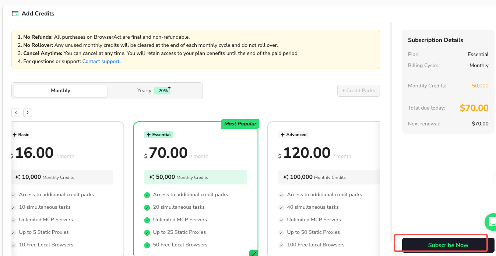
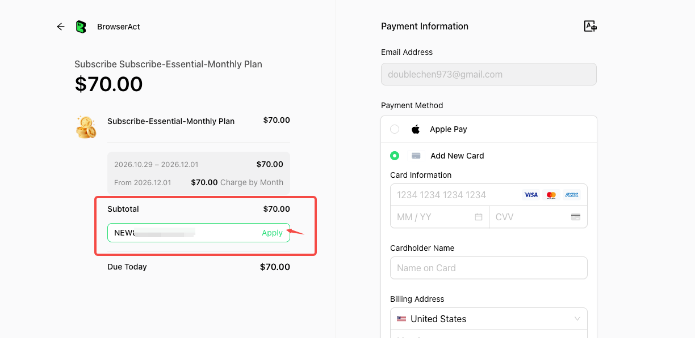
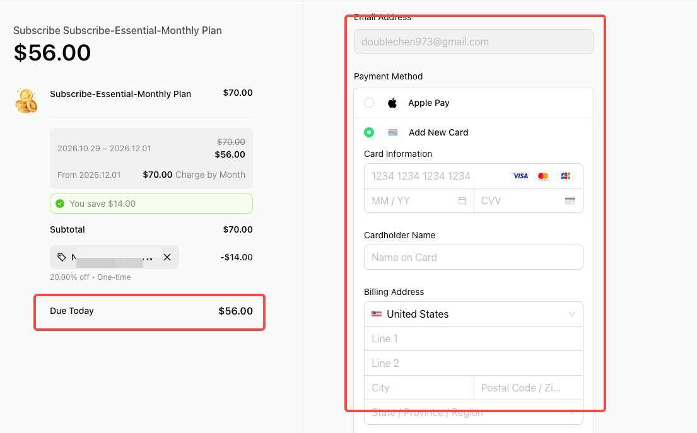

BrowserAct may offer discount codes during special promotions. These codes typically apply to a new user's first monthly subscription purchase. Check the terms provided with your code for its eligibility and validity.

## Before You Start

- Have your discount code ready.
- Select an eligible **Monthly** subscription plan.
- Check that your purchase meets the promotion's conditions.

## Step 1: Choose Your Subscription Plan

1. Open **Plan & Billing** in BrowserAct.
2. Select **Monthly**.
3. Choose the plan you want to subscribe to.
4. Select **Subscribe Now** to open checkout.

## Step 2: Apply Your Discount Code

1. On the checkout page, find the discount code field below **Subtotal** in the order summary on the left.
2. Enter your discount code.
3. Select **Apply**.

## Step 3: Review the Discount and Complete Payment

1. Confirm that the discount appears in the order summary.
2. Check the updated **Due Today** amount.
3. Review the renewal price and any one-time discount label shown at checkout.
4. Enter your payment and billing information.
5. Complete payment using the checkout button.

The amounts shown in these screenshots are examples. Your discount, amount due, and renewal price depend on the code and the checkout details. A one-time discount does not mean that future renewals receive the same discount.

## FAQ

### Can I use a discount code for a yearly plan or a renewal?

Discount codes typically apply to new users making their first monthly subscription purchase. Do not assume a code applies to yearly plans or renewals; check the promotion's terms.

### What should I do if my code is not accepted?

Check that you entered the code correctly, selected an eligible monthly plan, and meet the code's validity and first-purchase conditions. If it still does not work, contact [BrowserAct online support](https://www.browseract.com/?support=messages&co-from=link-Docs). If the panel does not open automatically, select the customer support button and open **Messages**.
