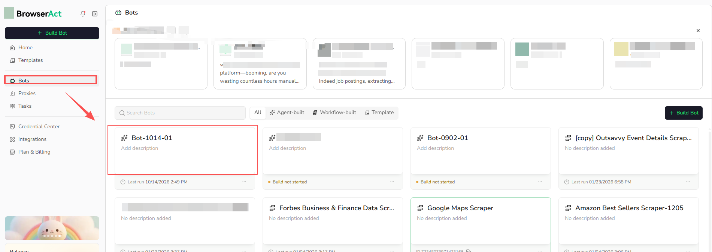
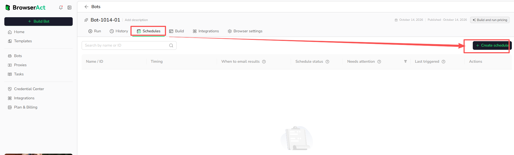
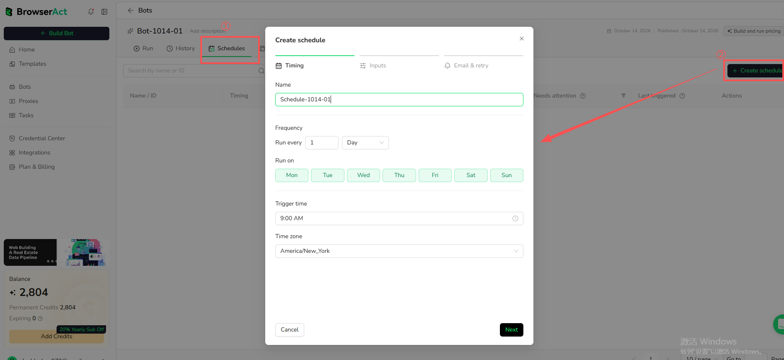
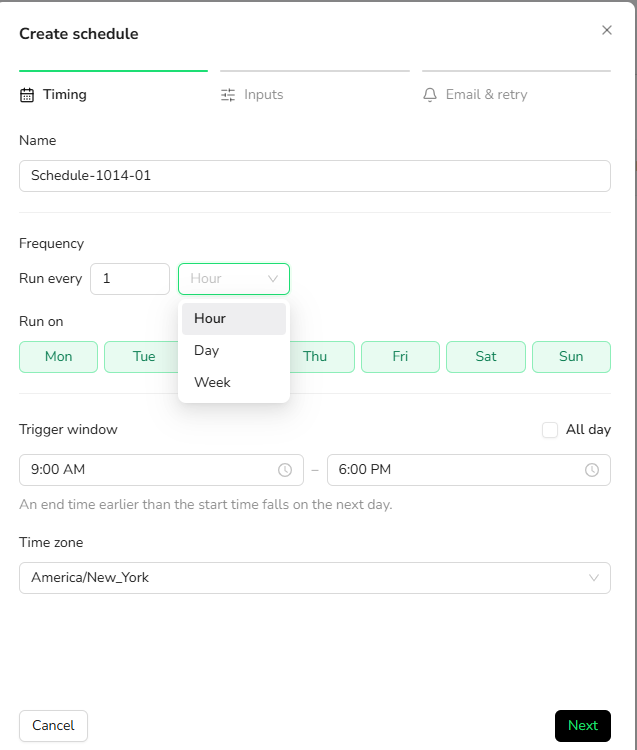
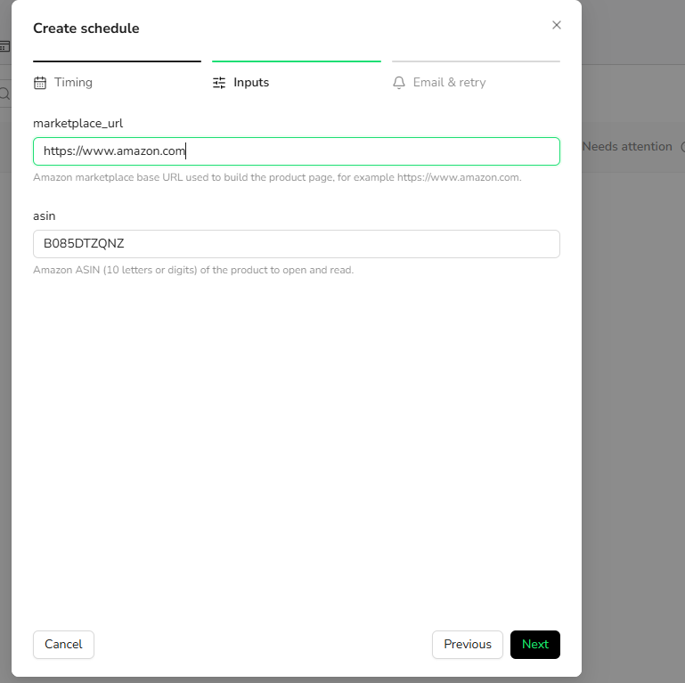
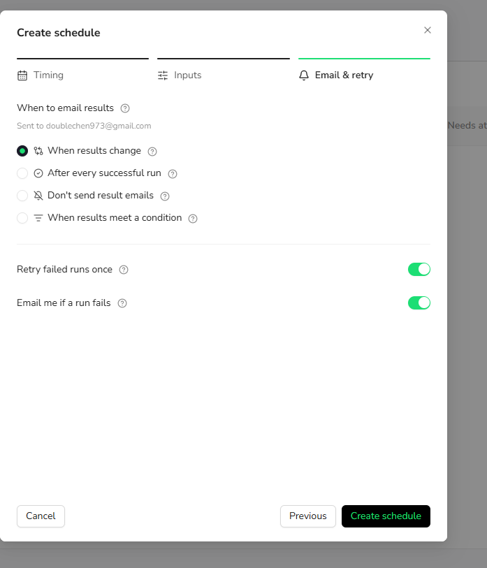
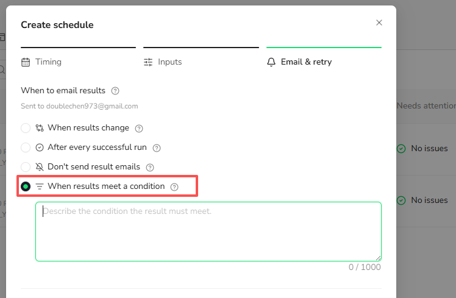
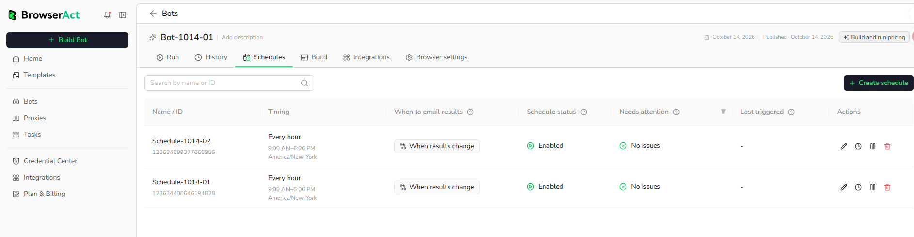
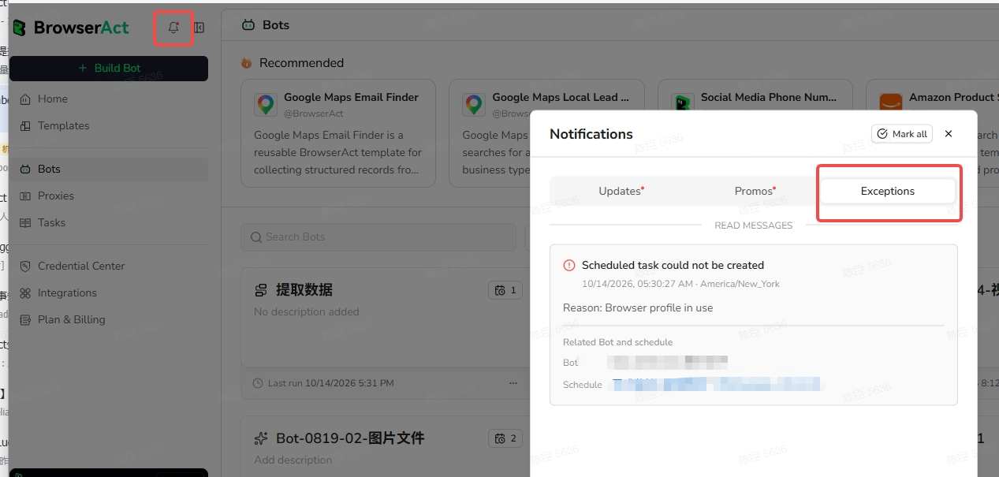

Use schedules to run a published BrowserAct Bot automatically.

A schedule stores the timing, inputs, email settings, retry settings, and run history for a recurring Bot run. You can create multiple schedules for the same Bot when you want to monitor different products, pages, keywords, or URLs.

Schedules are useful when you want BrowserAct to:

- Check product prices or availability on a recurring basis
- Track search results, listings, leads, jobs, or market data
- Refresh data at a fixed time or interval
- Email you when results change, or when an Agent Built Bot result meets a condition

Schedules run Bots based on the timing you configure. They are not real-time monitoring.

## Step 1: Open the Bot

1. Go to `Bots`.
2. Select the Bot you want to schedule.
3. Open the Bot detail page.



## Step 2: Open Schedules

1. Click the `Schedules` tab.
2. Click `Create schedule`.



## Step 3: Set Schedule Timing

In the `Timing` step, configure when BrowserAct should run the Bot.

- `Name`: enter a name for this schedule.
- `Frequency`: choose how often the Bot should run. Supported options are `Hour`, `Day`, and `Week`.
- `Run on`: choose the days when the schedule should run.
- `Trigger time` or `Trigger window`: choose when the run should be triggered.
  - Use a specific time if the Bot should run at a fixed time.
  - Use a time window if the Bot can run during a range, such as 9:00 AM to 6:00 PM.
  - Select `All day` if the Bot can run at any time during the day.
- `Time zone`: choose the time zone used to calculate the schedule.

Click `Next` when the timing settings are ready.





## Step 4: Configure Schedule Inputs

In the `Inputs` step, confirm the values this schedule will use each time it runs.

The fields shown here come from the published Bot's input settings. BrowserAct fills in default values when they are available. You can keep the defaults or update the values for this schedule.

For example, a product tracking Bot may include inputs such as:

- `marketplace_url`: the marketplace base URL, such as `https://www.amazon.com`
- `asin`: the Amazon product ASIN to open and read

If a required input does not have a default value, enter a valid value before continuing.



### Monitor multiple products or URLs

Create a separate schedule for each set of inputs you want to monitor.

For example, if you want to monitor multiple products, create one schedule for each product and enter a different product identifier, URL, or input value in the `Inputs` step.

Each schedule keeps its own timing, inputs, email settings, retry settings, and run history.

Click `Next` after the inputs are ready.

## Step 5: Configure Email & Retry

In the `Email & retry` step, choose when BrowserAct should email schedule results and how failed runs should be handled.

Schedule result emails are sent to the email address linked to your BrowserAct account by default. You can check the recipient shown under `When to email results`.

### When to email results

Choose one result email option:

- `When results change`: send an email only when the schedule finds a change compared with the previous successful result.
- `After every successful run`: send an email after each successful scheduled run.
- `Don't send result emails`: do not send emails for successful scheduled runs.
- `When results meet a condition`: for Agent Built Bots only, send an email only when the run result meets the condition you describe.



### Condition-based email notifications

Use `When results meet a condition` when you only want to be notified in a specific situation.

This option is currently supported only for schedules created from Agent Built Bots.

After selecting this option, describe the condition the result must meet.

```text
Email me when the product price drops below 50 dollars.
```

BrowserAct evaluates the scheduled run result against this condition and sends an email only when the condition is met.



### Retry and failure alerts

Use the retry and failure options based on how you want failed runs to be handled:

- `Retry failed runs once`: automatically create one retry run if a scheduled run fails.
- `Email me if a run fails`: send an email when a scheduled run fails.

Click `Create schedule` after the email and retry settings are ready.

## After Creating a Schedule

After the schedule is created, it appears in the Bot's `Schedules` tab.

The schedule list shows information such as:

- `Name / ID`
- `Timing`
- `When to email results`
- `Schedule status`
- `Needs attention`
- `Last triggered`

Use this list to check whether a schedule is enabled, whether it needs attention, and when it was last triggered.



## Review Exception Notifications

You can also review exception notifications from the global notification panel.

1. Click the bell icon in the top navigation.
2. Select the `Exceptions` tab.
3. Review any exception messages that need attention.

The `Exceptions` tab is useful when you want to check whether a scheduled run or recurring Bot setup has produced an issue that needs follow-up. Exception messages can show why a scheduled task could not be created and which Bot or schedule is related to the issue.


