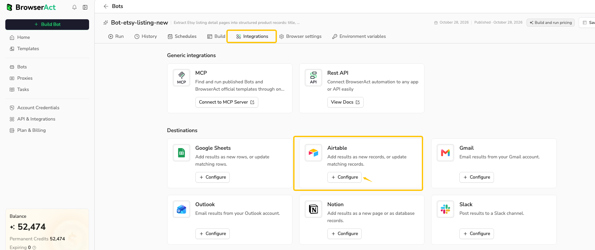
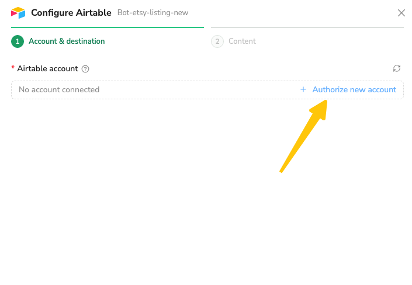
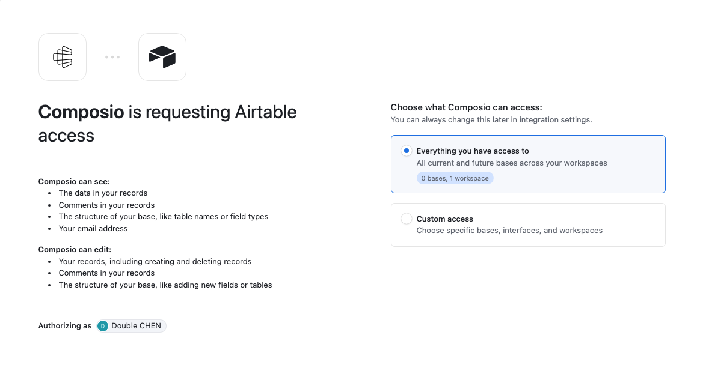
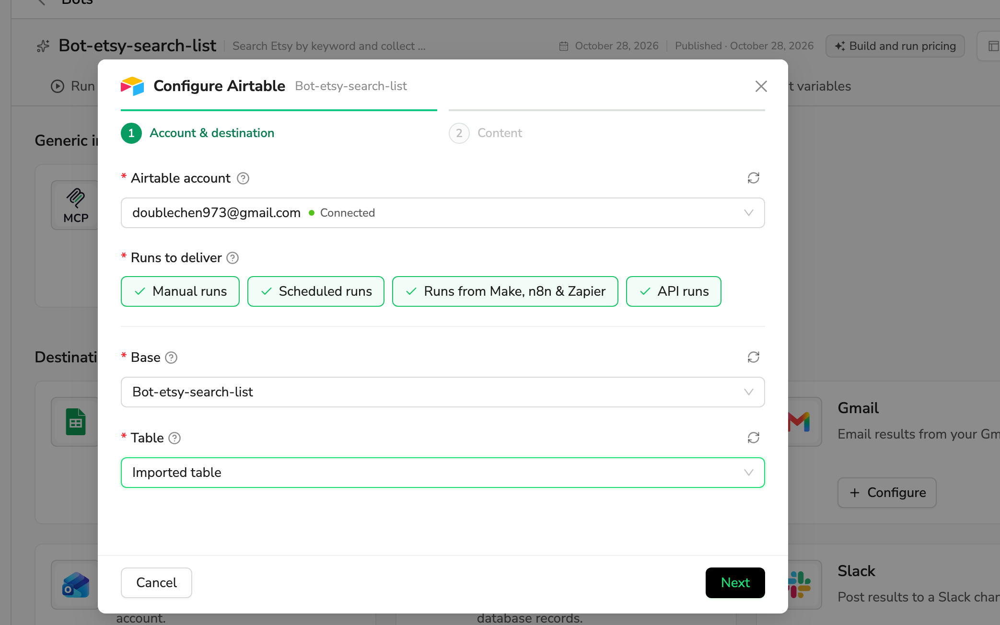
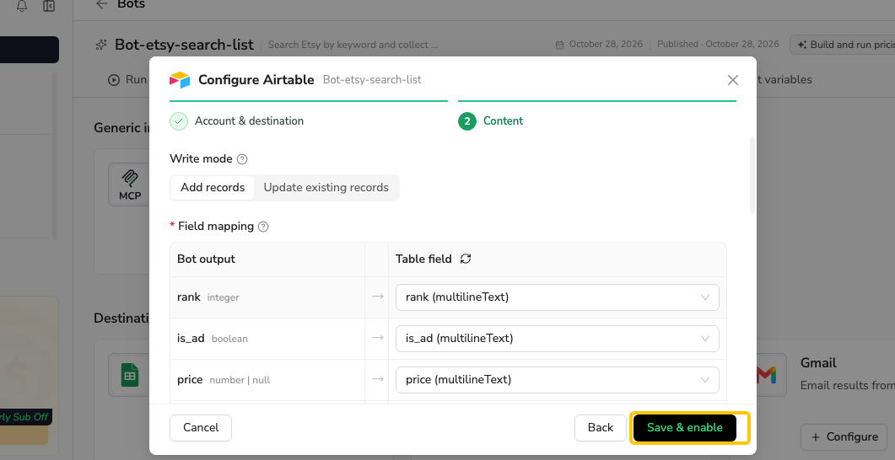
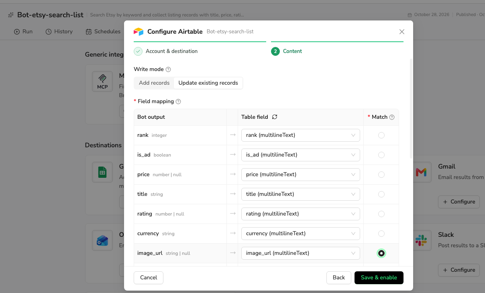
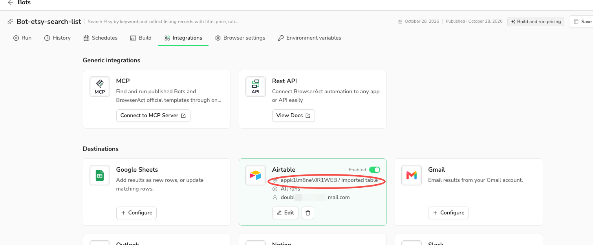
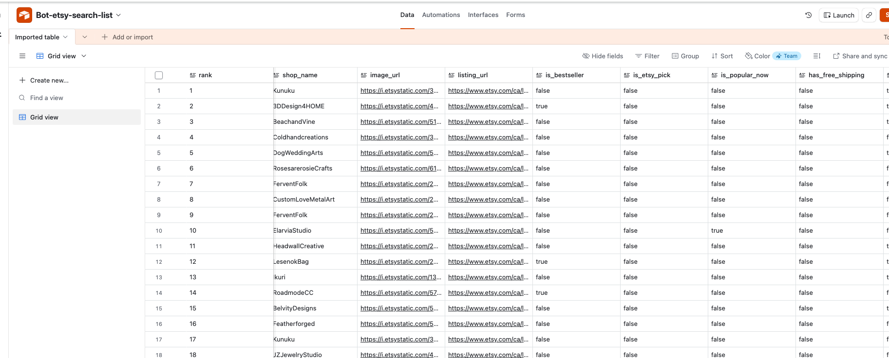

Add Bot results as new records or update matching records in an Airtable table.

## Before you start

- Use a published Agent-built Bot with a result table.
- Create an Airtable **base** and a **table** with fields for your Bot's output.
- Use an account with write access to the table.

For setup, see Airtable's guides to [create a base](https://support.airtable.com/articles/7403739720-creating-and-managing-airtable-bases) and [create a table](https://support.airtable.com/articles/6134745429-creating-and-managing-tables-in-airtable).

## 1. Connect Airtable

Open your Bot → **Integrations** → **Airtable → Configure**.

In **Account & destination**, click **Authorize new account**. Composio, BrowserAct's integration partner, opens authorization in a new window.

Grant access to the destination base. If you choose **Custom access**, include that base, then complete authorization.

## 2. Select the table and run sources

Return to BrowserAct and confirm **Connected**. Choose your **Base** and **Table**; refresh either list if needed.

Under **Runs to deliver**, select at least one source: **Manual runs**, **Scheduled runs**, **Runs from Make, n8n & Zapier**, or **API runs**. Click **Next**.

Only successful runs from selected sources deliver results. See [delivery conditions](/integrations/integration-overview?co-from=link-Docs#delivery-conditions) for exclusions.

## 3. Set the write mode and field mapping

In **Content**, map each **Bot output** field you want to store to a **Table field**.

### Add records

Select **Add records** to create a new record for each result.

### Update existing records

Select **Update existing records** and choose **one mapped field** under **Match**, such as a product URL.

- Matching is exact, including capitalization and spaces.
- All matching records are updated, using only mapped fields.
- Unmatched results and empty Match values are skipped; no records are added.
- Empty values in other mapped fields may clear existing text fields.

## 4. Save and check delivery

Click **Save & enable**. The card shows the account, base, table, run sources, and **Enabled** switch. Saving does not send a test result.

Run the Bot from a selected source, then check Airtable for new or updated records.

In **History**, hover over or keyboard-focus **Delivery** beside **Status** to check the Airtable result or error. A successful run can have a failed delivery. See [delivery statuses](/integrations/integration-overview?co-from=link-Docs#check-delivery).

## Troubleshooting

| Problem | Fix |
| --- | --- |
| Base or table is missing | Create both, confirm authorization includes the base, then refresh. |
| No records are updated | Check the Match field and exact values. Unmatched results are skipped. |
| A field cannot be written | Check field mapping, Airtable field settings, and Delivery errors. |
| Nothing is delivered | Check Enabled, run success, selected source, and Delivery details. |
