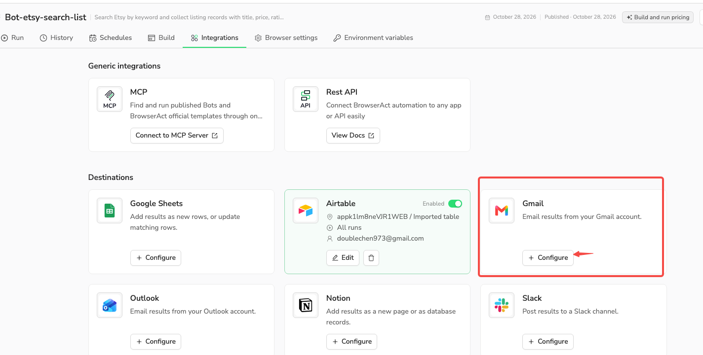
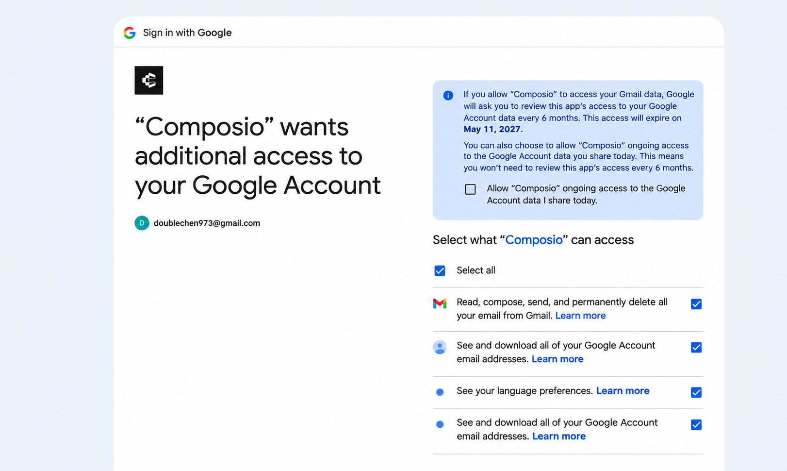
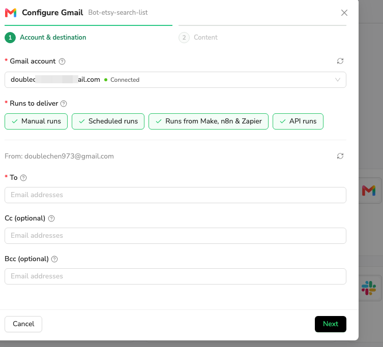
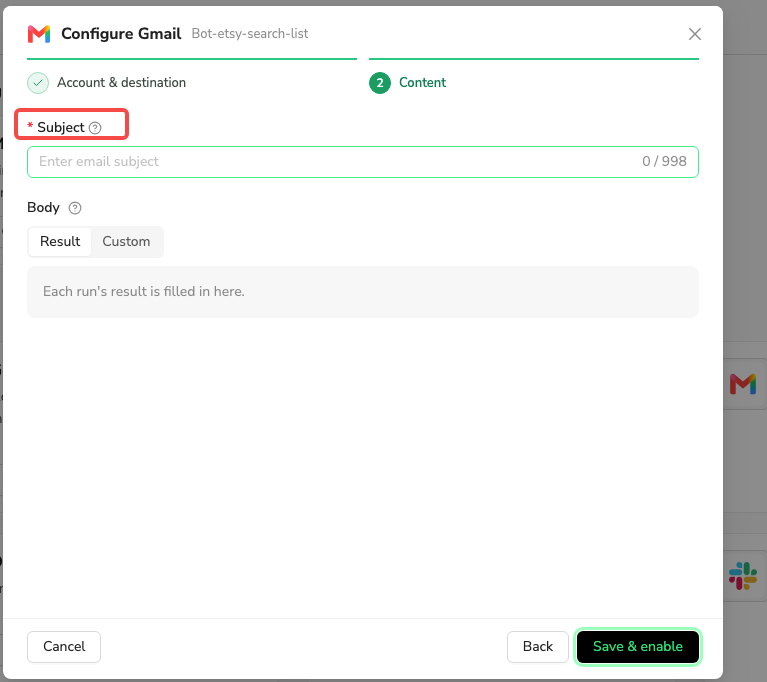
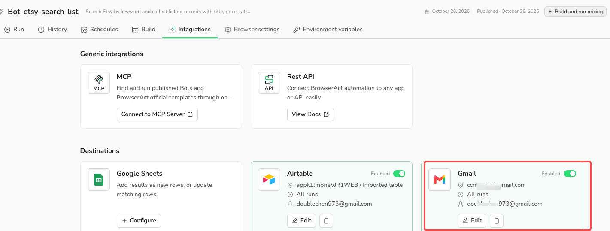
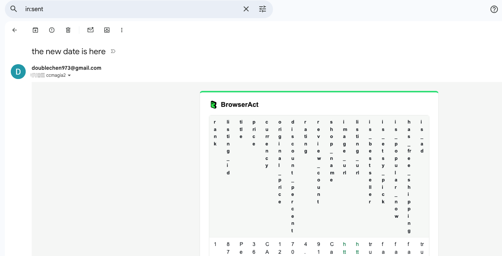

Email Bot results or a custom message from your Gmail account after successful runs.

## Before you start

- Use a published Agent-built Bot.
- Have access to the sending Gmail account and your recipients' addresses.

## 1. Connect Gmail

Open your Bot → **Integrations** → **Gmail → Configure**.

In **Account & destination**, select a connected account or authorize a new one. Composio, BrowserAct's integration partner, opens Google authorization in a new window.

Choose your account, review permissions, and complete authorization. Google's ongoing-access option is optional.

Return to BrowserAct. Confirm **Connected** and check the sender address under **From**.

## 2. Select run sources and recipients

Under **Runs to deliver**, select at least one source: **Manual runs**, **Scheduled runs**, **Runs from Make, n8n & Zapier**, or **API runs**.

Only successful runs from selected sources trigger email. See [delivery conditions](/integrations/integration-overview?co-from=link-Docs#delivery-conditions) for exclusions.

| Field | Recipients |
| --- | --- |
| **To** | Required; enter at least one address. |
| **Cc** | Optional; visible to all recipients. |
| **Bcc** | Optional; hidden from other recipients. |

**To, Cc, and Bcc support up to 100 addresses combined.** Click **Next**.

## 3. Set the subject and body

In **Content**, enter a **Subject** and choose a **Body** mode:

- **Result**: include the run's data.
- **Custom**: enter your own message.

With **Result**, the body previews up to 100 rows. The full result is attached in its original format and filename. If it exceeds the platform's attachment limit, the email omits it and directs recipients to download the result in BrowserAct.

## 4. Save and check delivery

Click **Save & enable**. Use **Edit** to change settings or **Enabled** to pause delivery. Saving does not send a test email.

Run the Bot from a selected source. Check the sender's **Sent** folder and the run's **Delivery** details. A sent message does not confirm receipt; check the recipient's inbox or spam folder if needed.

In **History**, hover over or keyboard-focus **Delivery** beside **Status** to view the Gmail result or error. See [delivery statuses](/integrations/integration-overview?co-from=link-Docs#check-delivery).

## Troubleshooting

| Problem | Fix |
| --- | --- |
| Account is disconnected | Complete authorization, or reconnect if it has expired. |
| Recipients cannot be saved | Include a To address and keep the combined total within 100. |
| No email is triggered | Check Enabled, run success, selected source, and Delivery errors. |
| Body has no result data | Set Body to Result. |
| Preview is shortened or attachment is missing | Preview is limited to 100 rows. Check the attachment or follow the BrowserAct download instruction for oversized results. |
| Recipient cannot find the email | Check the address, Sent folder, spam folder, and Delivery errors. |
