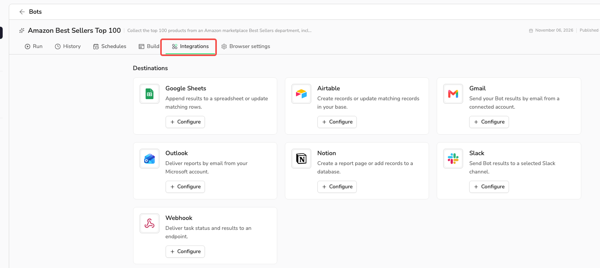
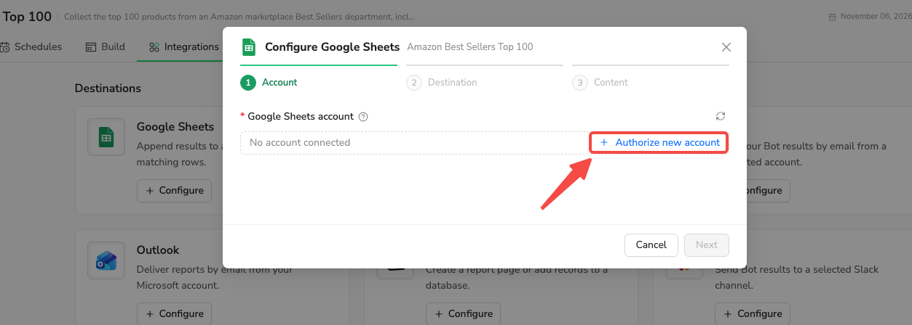
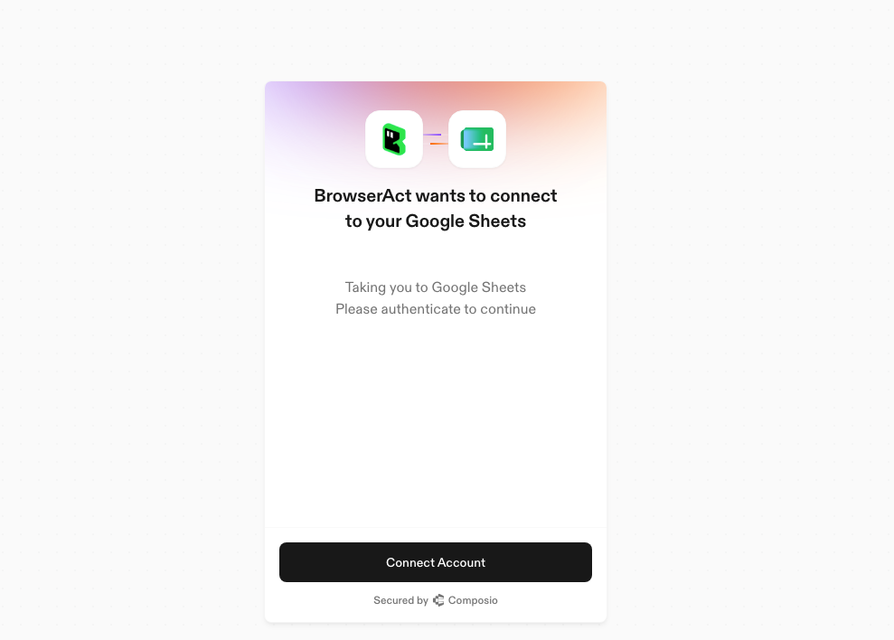
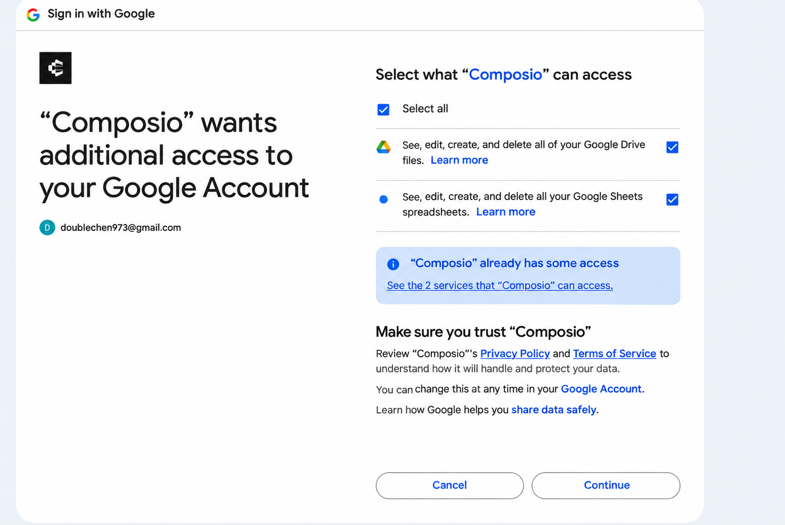
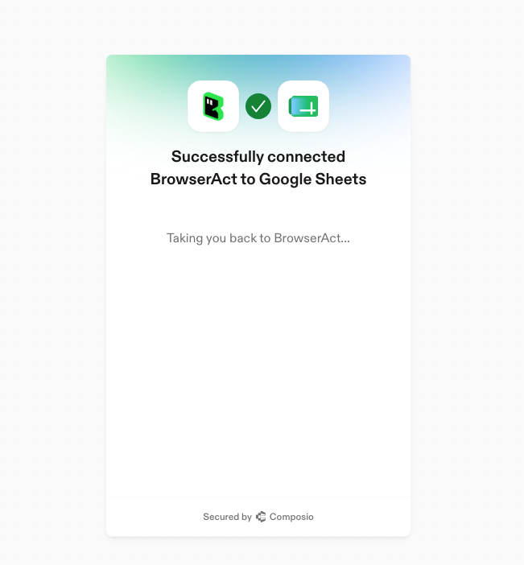
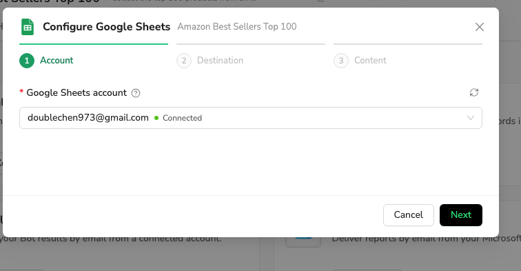
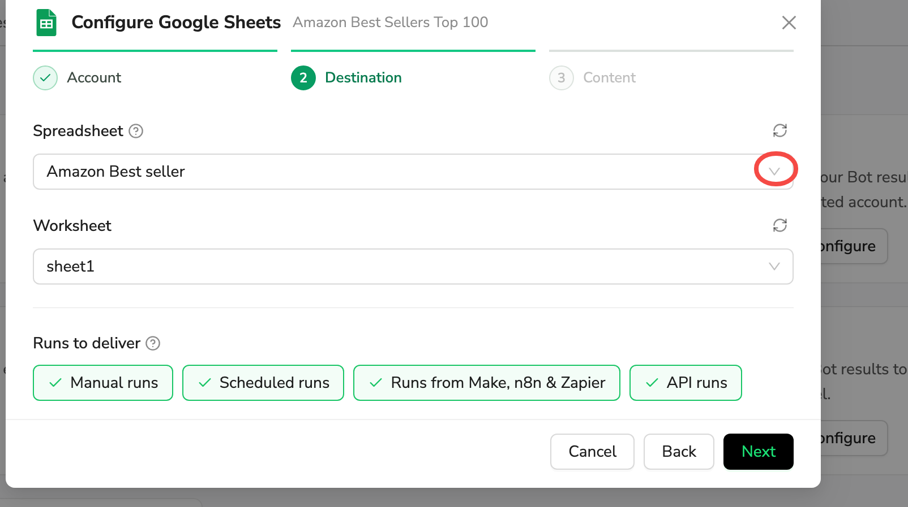
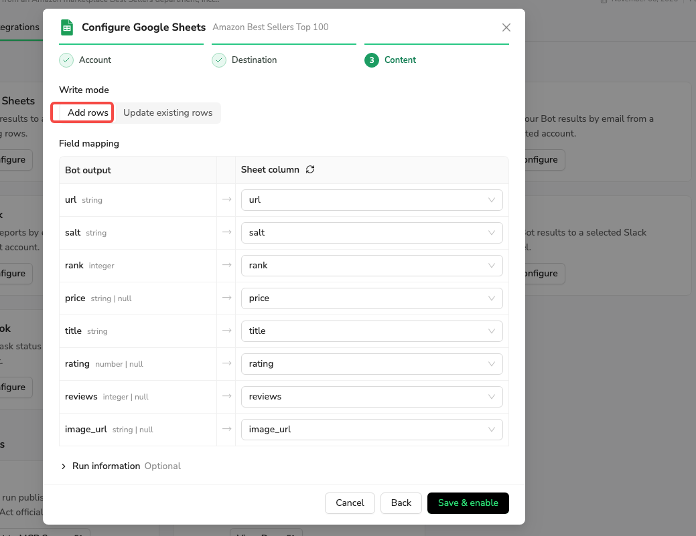
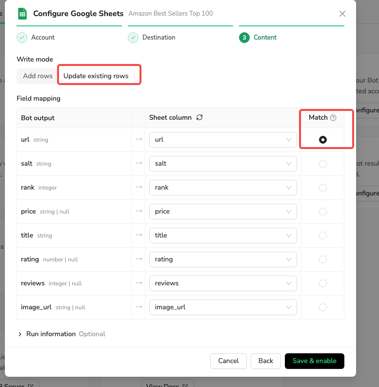

Add Bot results as new rows or update matching rows in a worksheet.

## Before you start

- Use a published Agent-built Bot with a result table.
- Create a spreadsheet and worksheet; give the Google account edit access.
- Add column headers matching the Bot's result fields, such as `url`, `rank`, `price`, and `title`.

## 1. Connect Google Sheets

Open your Bot → **Integrations** → **Google Sheets → Configure**.

In **Account**, click **Authorize new account**. Composio, BrowserAct's integration partner, opens authorization in a new window.

Click **Connect Account** and choose your Google account.

Select both requested Google Drive and Google Sheets permissions, then click **Continue**.

After authorization succeeds, return to BrowserAct.

Confirm **Connected**, then click **Next**.

## 2. Select the worksheet and run sources

In **Destination**, choose your **Spreadsheet** and **Worksheet**. Refresh the list if either is missing.

Under **Runs to deliver**, select at least one source: **Manual runs**, **Scheduled runs**, **Runs from Make, n8n & Zapier**, or **API runs**. Click **Next**.

Only successful runs from selected sources deliver results. See [delivery conditions](/integrations/integration-overview?co-from=link-Docs#delivery-conditions) for exclusions.

## 3. Set the write mode and field mapping

In **Content**, map each **Bot output** field to its **Sheet column**.

### Add rows

Select **Add rows** to append each result as a new row.

### Update existing rows

Select **Update existing rows** and choose **one mapped field** under **Match**, such as `url`.

- Matching is exact, including capitalization and spaces.
- All matching rows are updated, using only mapped columns.
- Unmatched results and empty Match values are skipped; no new rows are added.
- Empty values in other mapped fields may clear existing cells.

## 4. Save and check delivery

Click **Save & enable**; saving does not send a test result. Run the Bot from a selected source, then check the worksheet for added or updated rows.

In **History**, hover over or keyboard-focus **Delivery** beside **Status** to check the Google Sheets result or error. A successful run can have a failed delivery. See [delivery statuses](/integrations/integration-overview?co-from=link-Docs#check-delivery).

## Troubleshooting

| Problem | Fix |
| --- | --- |
| Authorization fails | Allow the authorization window and select both requested Google permissions. |
| Spreadsheet or worksheet is missing | Create it first, check account access, then refresh the list. |
| Fields do not line up | Check worksheet headers, refresh columns, and review field mapping. |
| No rows are updated | Check the Match field and exact values. Unmatched results are skipped. |
| Nothing is delivered | Check Enabled, run success, selected source, and Delivery errors. |
