Save each run as a page, or add and update records in a Notion database.

## Before you start

- Use a published Agent-built Bot.
- Create a Notion parent page or database. For databases, prepare properties for the Bot's output.
- Make sure you can authorize the workspace and connect the target.

## 1. Connect Notion

Open your Bot → **Integrations** → **Notion → Configure**.

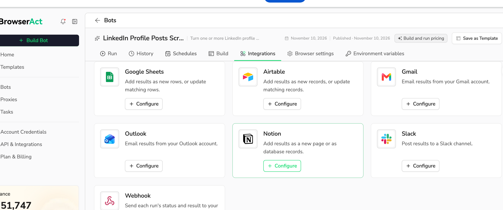

In **Account & destination**, click **Authorize new account**. Composio, BrowserAct's integration partner, opens authorization in a new window.

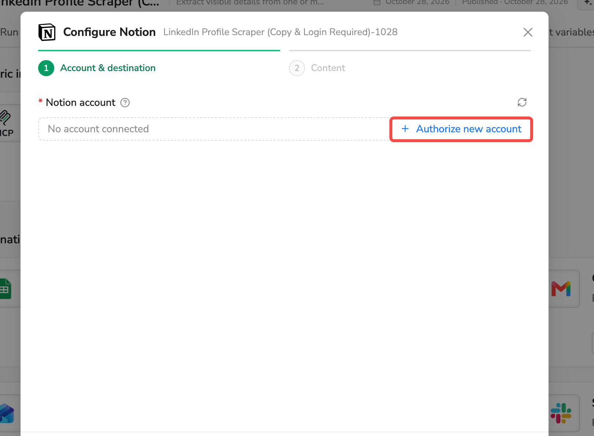

Choose the workspace, review permissions, and click **Select pages**.

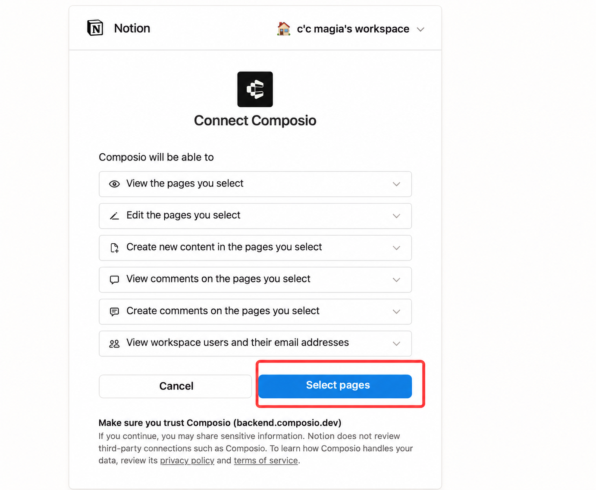

Select the pages and click **Allow access**.

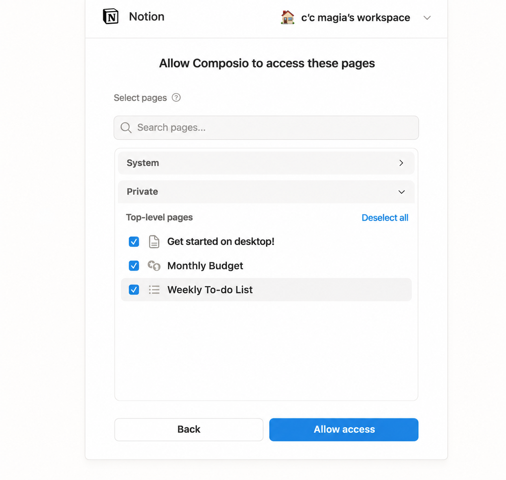

Return to BrowserAct and **refresh the page**. Reopen the configuration if needed and confirm **Connected**.

## 2. Grant access to the target in Notion

**Workspace authorization alone is not enough.** Add the Composio connection to the specific page or database:

1. Open the target's **•••** menu.
2. Select **More → Connections → Composio**.

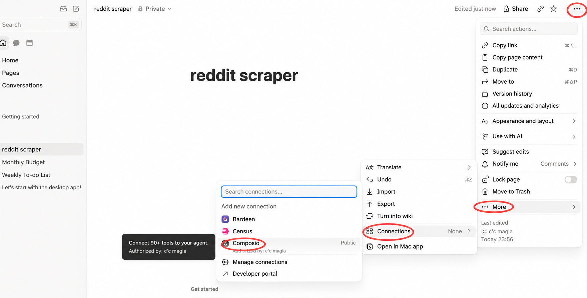

3. Click **Add to page**. This also grants access to subpages.

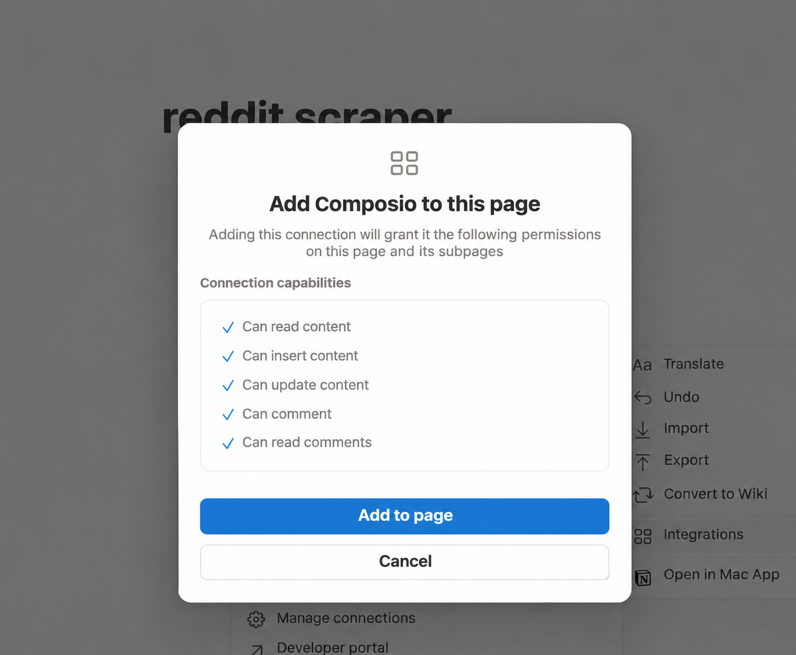

Menu labels may vary; see [Notion's connection guide](https://www.notion.com/help/add-and-manage-connections-with-the-api#add-connections-to-pages). Return to BrowserAct and refresh the target list.

## 3. Select run sources and a destination

Under **Runs to deliver**, select at least one source: **Manual runs**, **Scheduled runs**, **Runs from Make, n8n & Zapier**, or **API runs**.

Only successful runs from selected sources deliver results. See [delivery conditions](/integrations/integration-overview?co-from=link-Docs#delivery-conditions) for exclusions.

Under **Deliver to**, choose **Parent page** or **Database**.

### Parent page

Select the connected parent page. Refresh the list if it is missing.

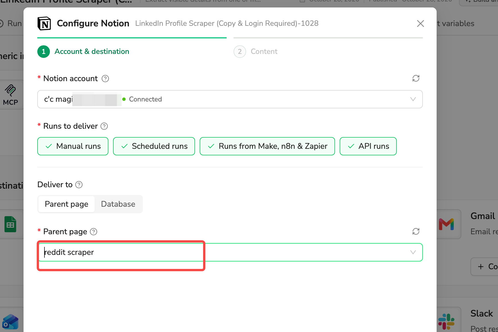

Click **Next**. In **Content**, enter a **Page title**. Each run creates a child page containing the full result.

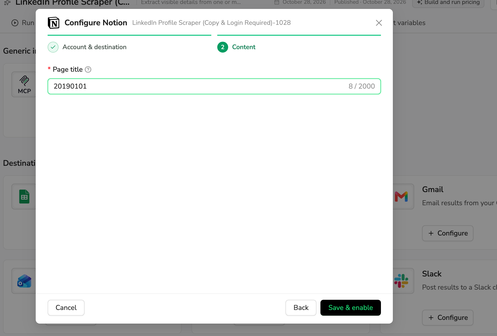

### Database

Prepare the database properties and add the Composio connection as described above.

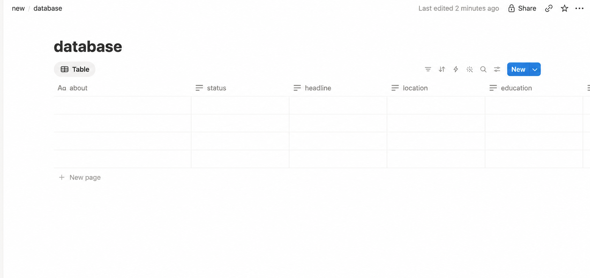

In BrowserAct, choose **Database**, refresh the list, and select your database. Click **Next**.

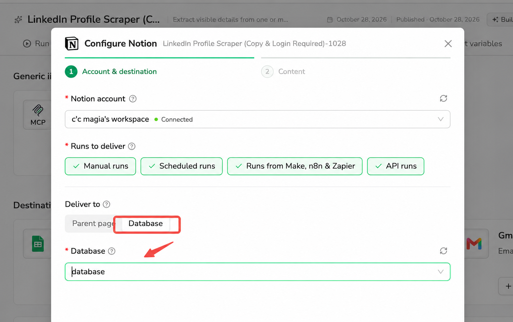

In **Content → Field mapping**, map each **Bot output** to a **Database property**. Select **Don't write** to exclude a field.

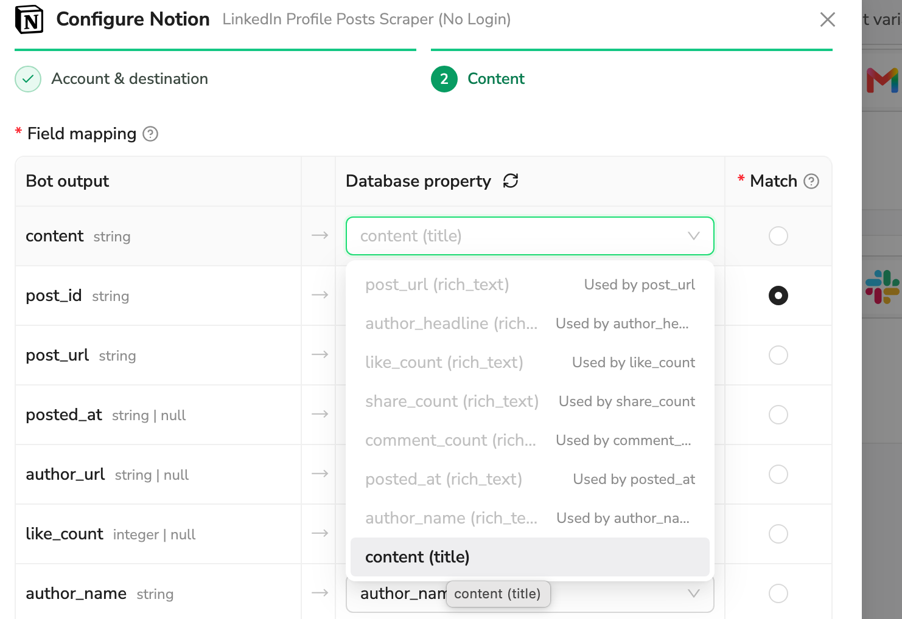

Choose **one mapped field** under **Match** to identify records, such as `post_id`. Matching records are updated with the mapped values; if no record matches, a new record is added.

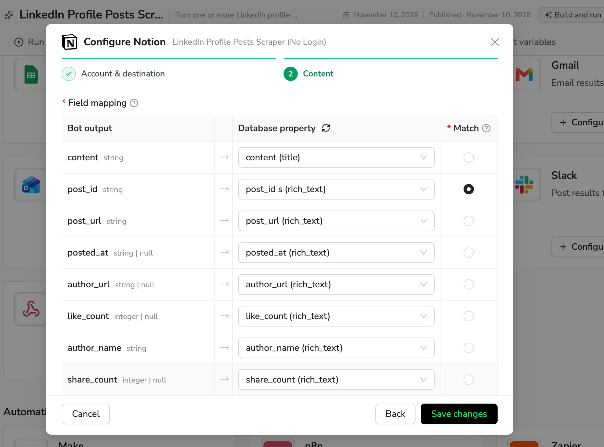

## 4. Save and check delivery

Click **Save & enable**, or **Save changes** when editing. The card shows the target, run sources, account, and **Enabled** switch. Saving does not send a test result.

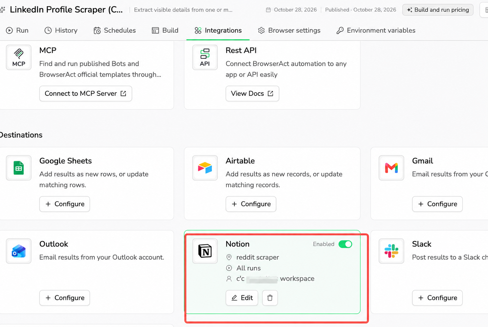

Run the Bot from a selected source. In **History**, hover over or keyboard-focus **Delivery** beside **Status** to view the Notion result or error. A successful run can have a failed delivery. See [delivery statuses](/integrations/integration-overview?co-from=link-Docs#check-delivery).

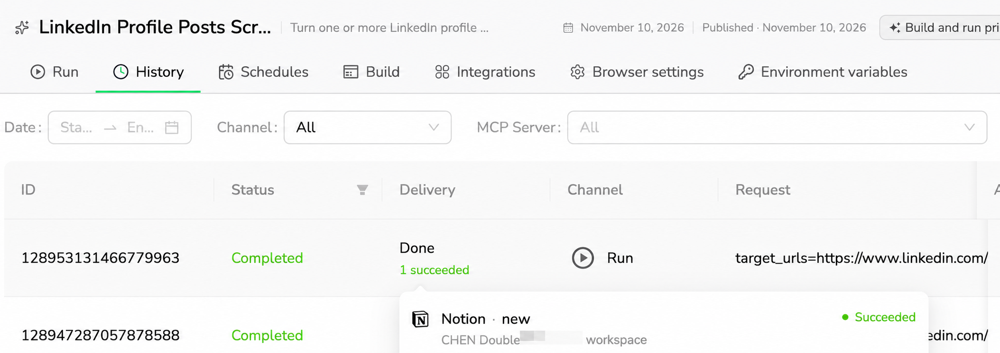

In Notion, check the new child page or database records. For databases, confirm that matching records were updated and unmatched results were added with the expected properties.

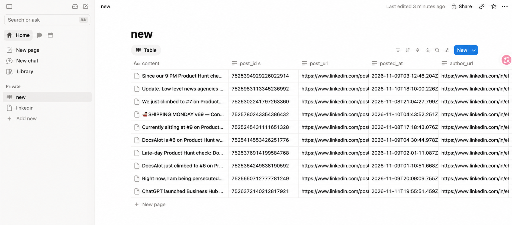

## Troubleshooting

| Problem | Fix |
| --- | --- |
| Account state has not updated | Refresh BrowserAct and reopen the configuration. |
| Page or database is missing | Check the workspace, add Composio to that target, then refresh the list. |
| Database list times out | Check account and target permissions, then retry. Keep the error message if it persists. |
| No content is delivered | Check Enabled, run success, selected source, and Delivery errors. |
| Database values are missing | Check field mapping, property types, Match selection, and Delivery details. |
