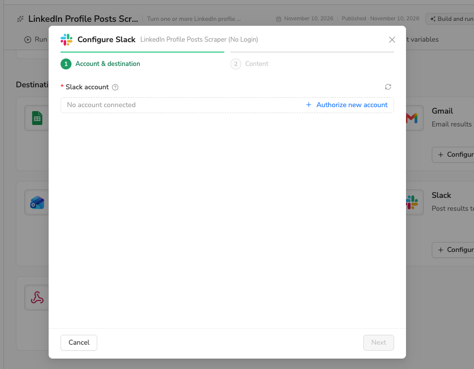
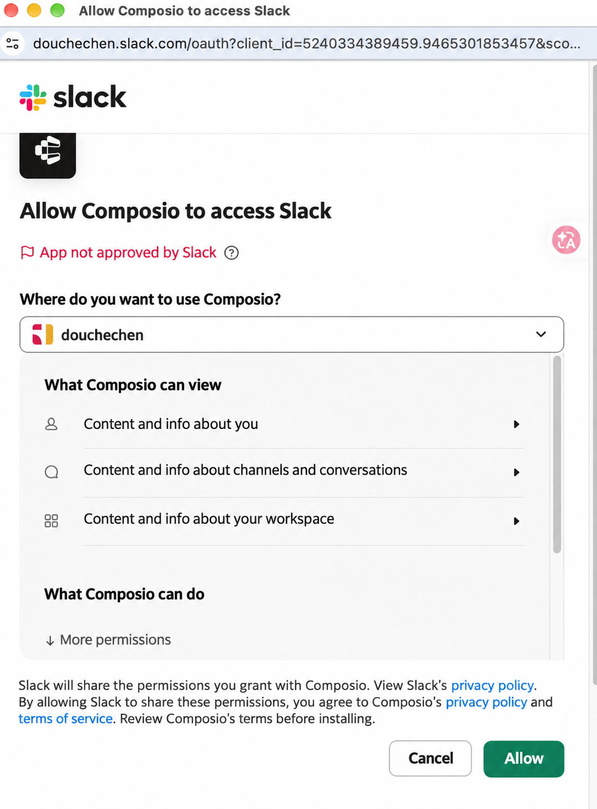
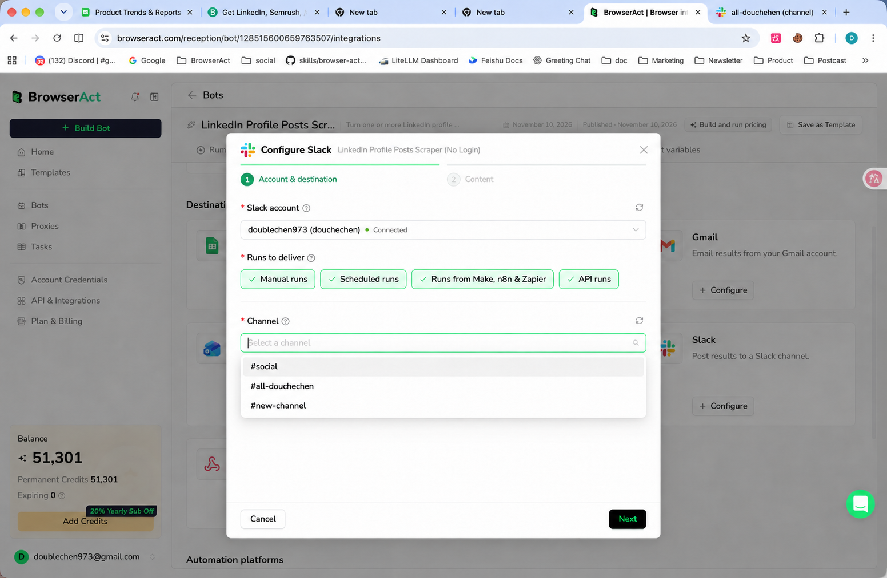
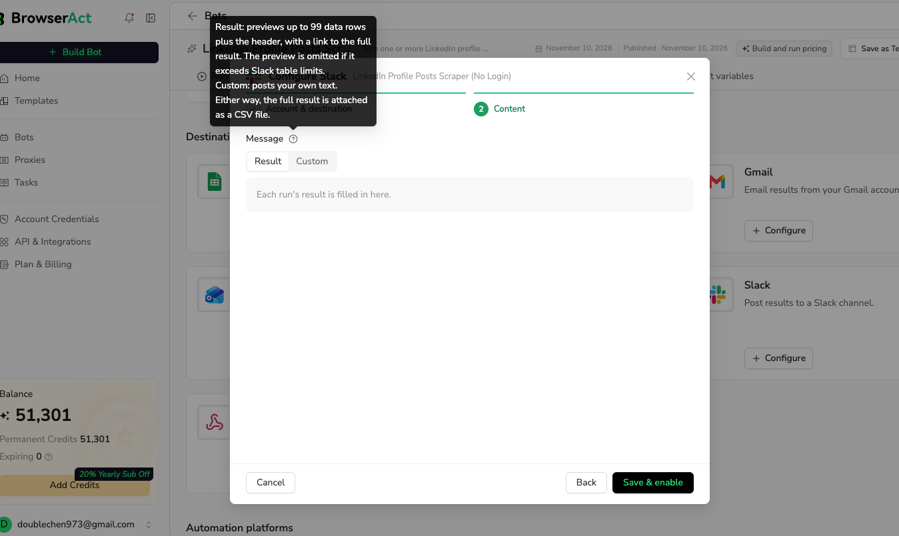
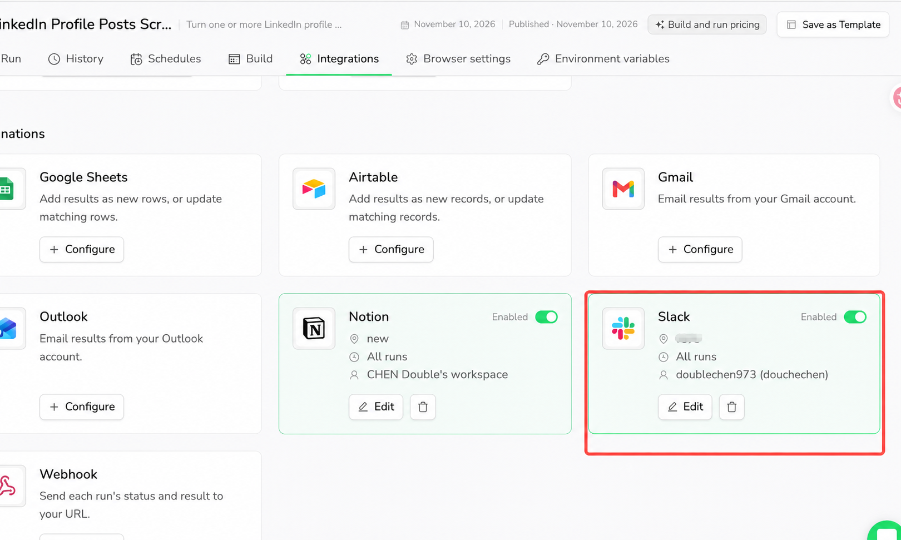
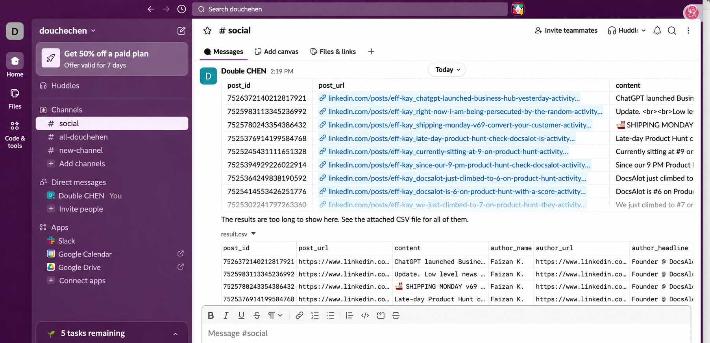

Post Bot results or a custom message to a Slack channel, with the full result attached as CSV.

## Before you start

- Use a published Agent-built Bot.
- Choose a workspace and channel; use an account that can authorize the connection and post there.

## 1. Connect Slack

Open your Bot → **Integrations** → **Slack → Configure**. In **Account & destination**, click **Authorize new account**.

Composio, BrowserAct's integration partner, opens authorization in a new window. Choose the workspace, review permissions, and click **Allow**.

Return to BrowserAct and confirm **Connected**.

## 2. Select run sources and a channel

Under **Runs to deliver**, select at least one source: **Manual runs**, **Scheduled runs**, **Runs from Make, n8n & Zapier**, or **API runs**.

Only successful runs from selected sources trigger delivery. See [delivery conditions](/integrations/integration-overview?co-from=link-Docs#delivery-conditions) for exclusions.

Select a **Channel**, refreshing the list if needed, then click **Next**.

## 3. Set the message content

In **Content**, choose a **Message** mode:

| Mode | Message |
| --- | --- |
| **Result** | Result preview and full-result link. Previews show up to 99 data rows plus the header; they are omitted if Slack's table limits are exceeded. |
| **Custom** | Your own message text. |

**Both modes attach the full result as a CSV file.**

## 4. Save and check delivery

Click **Save & enable**. Use **Edit** to change settings or **Enabled** to pause delivery. Saving does not send a test post.

Run the Bot from a selected source. Check the channel for the message and CSV attachment; open the CSV for all rows and fields.

In **History**, hover over or keyboard-focus **Delivery** beside **Status** to view the Slack result or error. A successful run can have a failed delivery. See [delivery statuses](/integrations/integration-overview?co-from=link-Docs#check-delivery).

## Troubleshooting

| Problem | Fix |
| --- | --- |
| Channel is missing | Check the workspace and account's channel access, then refresh. |
| No message appears | Check Enabled, run success, selected source, and Delivery errors. |
| Preview is shortened or missing | Open the CSV for the full result. Slack table limits may omit the preview. |
| Message has text instead of a table | Set Message to Result for a preview. Both modes include the CSV. |
