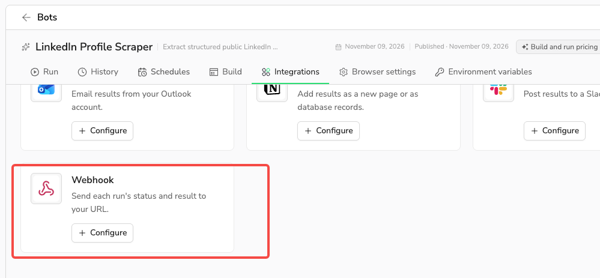
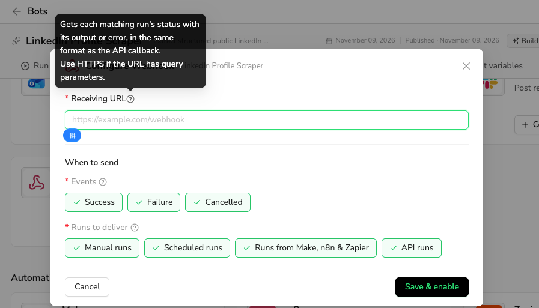
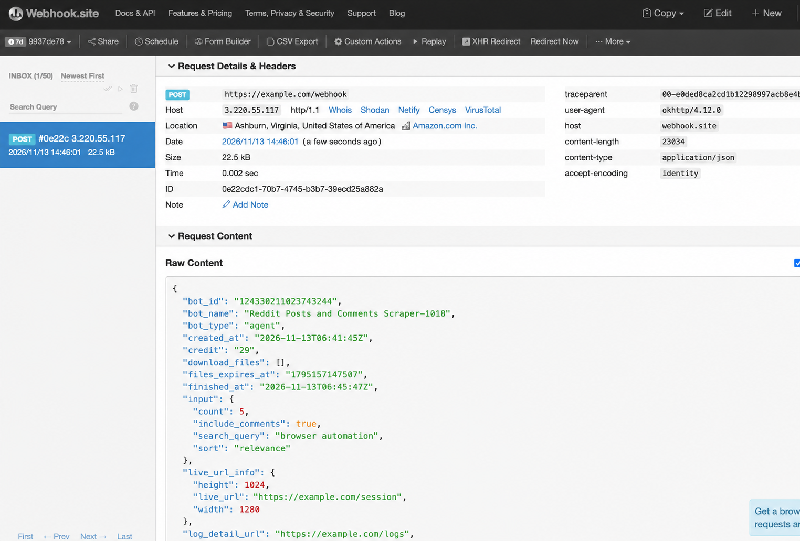

Send run status and output or error to a receiving URL as a JSON POST request, in the same format as the API callback.

## Before you start

- Use a published Agent-built Bot.
- Prepare an endpoint that accepts HTTP POST requests with a JSON body.

Webhook does not require Composio or third-party account authorization.

## 1. Open Webhook

Open your Bot → **Integrations** → **Webhook → Configure**.

## 2. Set the URL, events, and sources

Enter your **Receiving URL**. Use **HTTPS** if it contains query parameters.

Under **Events**, select at least one: **Success**, **Failure**, or **Cancelled**.

Under **Runs to deliver**, select at least one source: **Manual runs**, **Scheduled runs**, **Runs from Make, n8n & Zapier**, or **API runs**.

**Both the final event and run source must match.** MCP calls, build tasks, draft tests, and Bots reused inside a Workflow do not trigger the webhook.

## 3. Save and check delivery

Click **Save & enable**; saving does not send a test request.

Run the Bot from a selected source. When it ends with a selected event, check your receiver's request history or logs for the **POST** request, **Content-Type: application/json**, and body.

In **History**, hover over or keyboard-focus **Delivery** beside **Status** to view the Webhook result or error. See [delivery statuses](/integrations/integration-overview?co-from=link-Docs#check-delivery).

A failed or cancelled run can have a successful webhook delivery when that event is selected. Successful delivery means the receiver responded; check its logs to confirm downstream processing.

## Troubleshooting

| Problem | Fix |
| --- | --- |
| No request arrives | Check Enabled, the URL, selected source and event, Delivery details, and receiver logs. |
| Only success events arrive | Select Failure and Cancelled if you need those events. |
| URL with query parameters fails | Use HTTPS and check the Delivery error. |
| Delivery succeeds but no downstream action occurs | Check your receiver's processing rules and logs. |
