Run BrowserAct Bots and official templates from a Dify workflow, then pass their structured results to downstream nodes.

> **Marketplace review in progress:** The BrowserAct plugin is currently under review for the Dify Marketplace. Download the plugin package and install it using **Local Package File** for now.

## Before You Start

- Access to a Dify workspace where you can install plugins.
- A BrowserAct REST API key. An MCP Server key cannot be used for this integration.
- A published BrowserAct Bot, or an official template you want to run.
- The input values required by your Bot or template.

Create or manage your REST API key by following [API Keys](/integrations/api-keys?co-from=link-Docs).

## Step 1: Download and Install the Plugin

**1.** [Download the BrowserAct plugin package (.difypkg)](https://browseract-prod.browseract.com/prod/tools/browseract-1.0.0-view-properties-20261029.difypkg).

**2.** Open Dify and select **Integrations**.

**3.** Select **Install** > **Local Package File**.

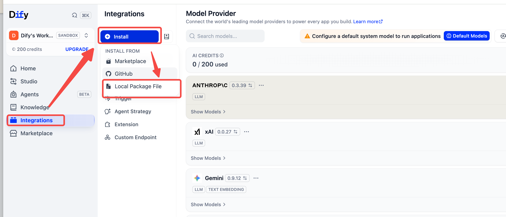

**4.** Select the downloaded `.difypkg` file.

**5.** Select **Install** in the confirmation dialog.

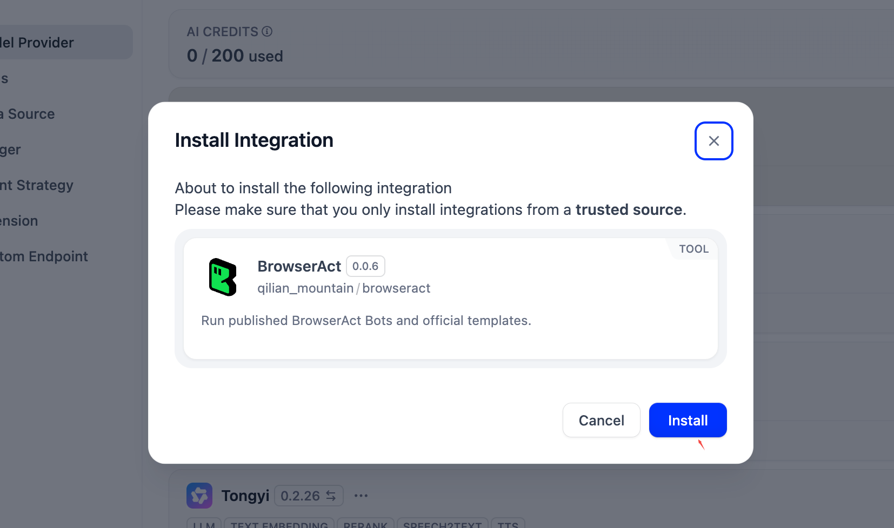

**6.** Wait for installation to finish.

## Step 2: Create a Dify Workflow

**1.** Open **Studio**.

**2.** Select **Create from Blank**. If you already have apps, use **Create** > **Create from Blank**.

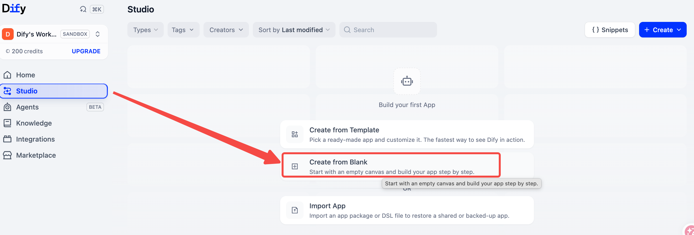

**3.** Select **Workflow** as the app type.

**4.** Enter an app name and an optional description.

**5.** Select **Create**.

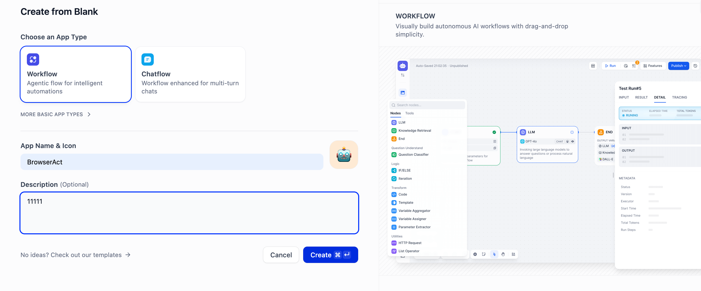

## Step 3: Add and Authorize BrowserAct

**1.** Add a node and open **Tools**.

**2.** Find **BrowserAct**.

**3.** Choose **Run My Bot** for your published Bot, or **Run Official Template** for an official template.

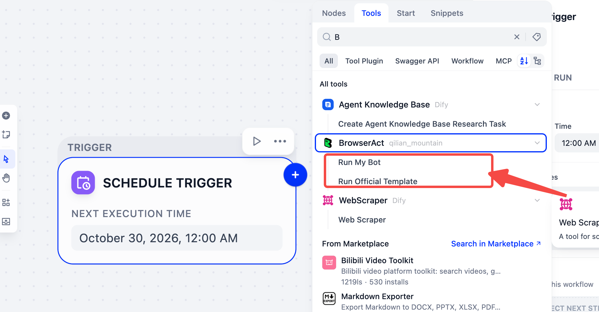

**4.** Select **API Key Authorization Configuration**.

**5.** Enter your BrowserAct REST API key. Need a key? Follow [Get a BrowserAct API Key](https://docs.browseract.com/integrations/api-keys?co-from=link-Docs).

**6.** Select **Save**.

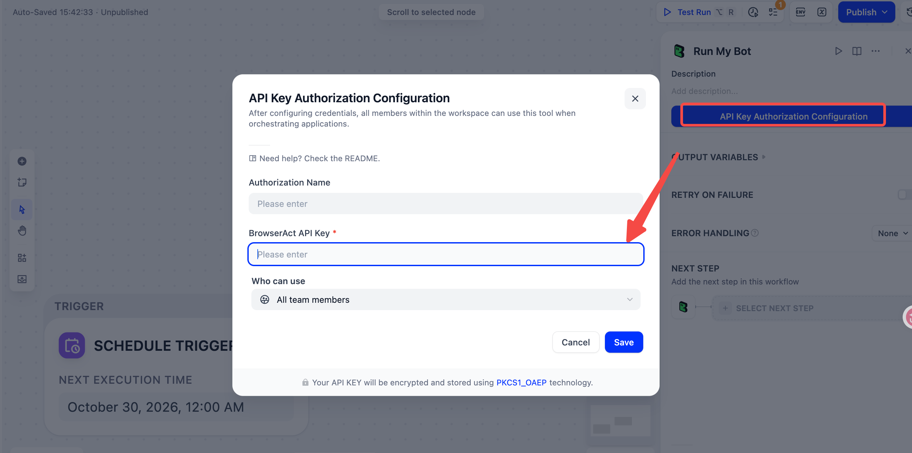

## Step 4: Configure Inputs

**1.** Set **Operation** to **View Parameters**.

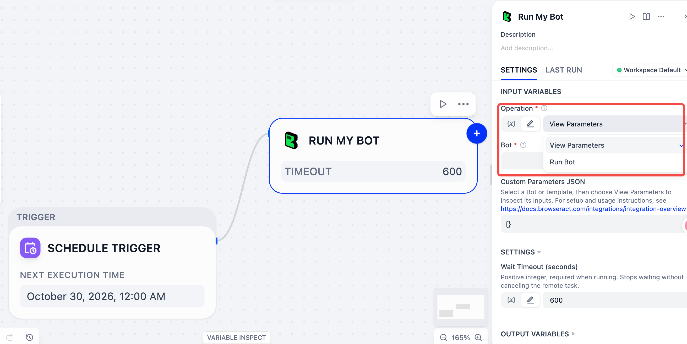

**2.** Select the Bot or template you want to use.

**3.** Select the play button on the node to inspect its inputs.

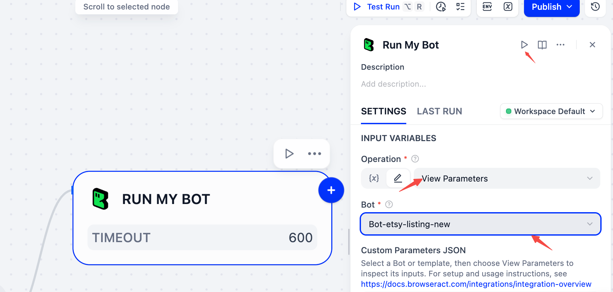

**4.** Open **LAST RUN**.

**5.** Copy the complete **OUTPUT**.

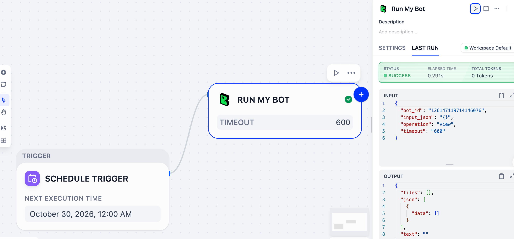

**6.** Return to **SETTINGS** and paste the output into **Custom Parameters JSON**.

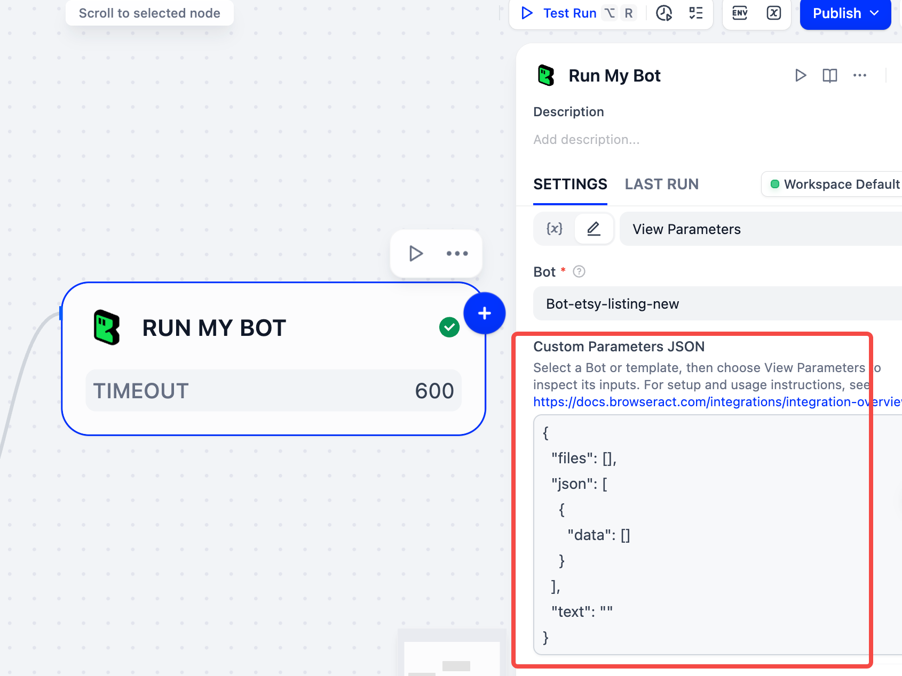

**7.** Edit the inputs in `json[0]`. Supply all required values, including those without defaults.

**8.** Change **Operation** back to **Run Bot**.

Both tools default to **Run Bot**. **View Parameters** only inspects inputs; an empty `data` array is not a completed extraction result. You may also enter a parameter object directly. `{}` uses available defaults but does not fill missing required values.

## Step 5: Run and Use the Results

**1.** Start a test run of the complete Dify workflow.

**2.** Wait for the BrowserAct Task result.

**3.** Open **Logs** in your Dify app to review workflow records when available.

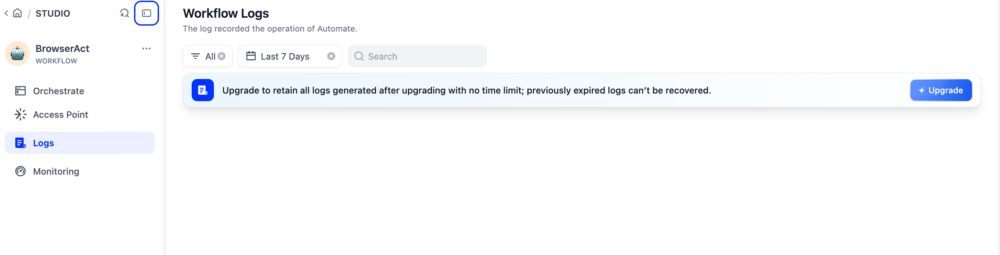

**4.** Map `task_id`, `status`, `output`, or `output_files` to downstream nodes as needed.

**Wait Timeout (seconds)** defaults to 600. A wait timeout does not cancel the BrowserAct Task. Check its status before retrying. Actual output fields and file formats depend on the response.

## FAQ

### Why can't I find BrowserAct in the Dify Marketplace?

The plugin is still under review. Use the package download and **Local Package File** installation steps above.

### Can I run both my Bots and official templates?

Yes. Select **Run My Bot** for a published Bot in your account, or **Run Official Template** for an official template.

### Why does authorization fail with my MCP key?

This plugin uses BrowserAct REST API authentication. Create a REST API key using [API Keys](/integrations/api-keys?co-from=link-Docs); MCP Server keys are managed separately.

### What if Dify stops displaying output while the Task is running?

Check Dify's run history and the Task status in BrowserAct before retrying. A disconnected live view or a wait timeout does not necessarily mean the BrowserAct Task stopped.
