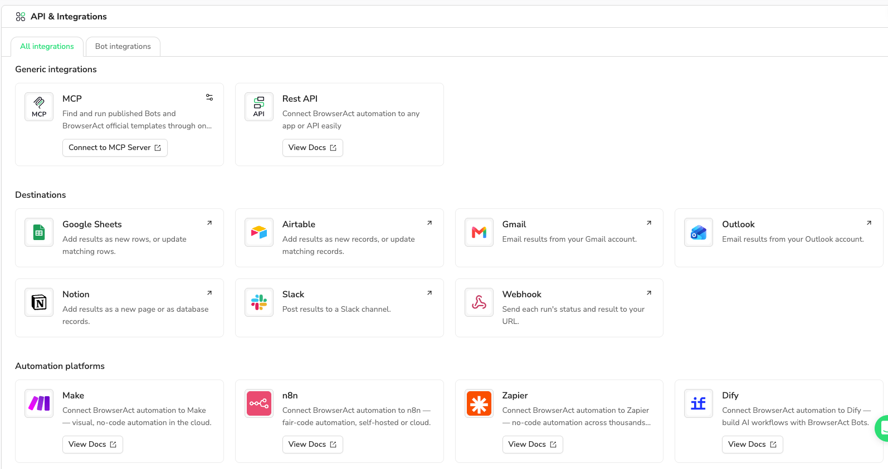
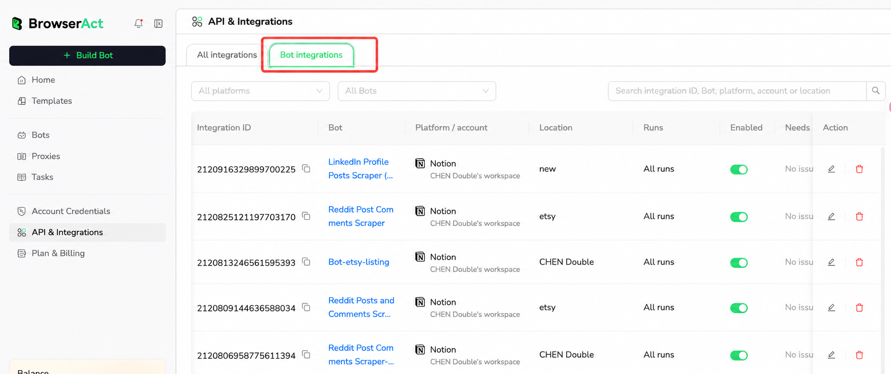

Connect BrowserAct to AI clients, applications, and automation platforms to run Bots and deliver results.

## Open API & Integrations

Select **API & Integrations** in the sidebar:

- **All integrations**: browse integrations by category.
- **Bot integrations**: manage saved destination configurations across Bots.

## Generic integrations

| Integration | Use it to | Get started |
| --- | --- | --- |
| **MCP** | Find and run published Bots and official templates from an AI client. | **Connect to MCP Server**, or read the [MCP guide](/integrations/mcp?co-from=link-Docs). |
| **Rest API** | Start runs and retrieve task status and results from your application. | **View Docs** on the Rest API card. |

For Key-based connections, the same API Key can be used with the unified BrowserAct MCP URL, a Custom MCP Server URL, and supported public REST API endpoints. Manage Keys in **API & Integrations → API Keys**. The selected endpoint and current permissions determine the available resources; revoking a shared Key stops every connection that uses it. See [API Keys & Authentication](/integrations/api-keys?co-from=link-Docs).

## Destinations

**Currently available only for published Agent-built Bots.**

| Destination | What it does |
| --- | --- |
| **Google Sheets** | Add rows or update matching rows. |
| **Airtable** | Add records or update matching records. |
| **Gmail** | Email results from Gmail. |
| **Outlook** | Email results from Outlook. |
| **Notion** | Save results as pages or database records. |
| **Slack** | Post results to a channel. |
| **Webhook** | Send run status and output or error to a receiving URL. |

Open a published Bot → **Integrations** → **Configure** on a destination card. Set the account, target, run sources, and content, then save. Webhook uses a receiving URL and events instead of account authorization.

A Bot can connect to multiple platforms, with **one saved configuration per platform**. Each has its own **Enabled** switch.

### Delivery conditions

Select at least one source: **Manual runs**, **Scheduled runs**, **Runs from Make, n8n & Zapier**, or **API runs**.

Account-based destinations deliver after successful runs from selected sources. Webhook can also deliver selected **Failure** and **Cancelled** events. MCP calls, build tasks, draft tests, and Bots reused inside a Workflow do not trigger destinations.

Saving a configuration does not send a test result.

## Automation platforms

| Platform | Use it to | Guide |
| --- | --- | --- |
| **Make** | Run a Bot in a scenario and pass results to other modules. | [Make](/integrations/make?co-from=link-Docs) |
| **n8n** | Run a Bot in a workflow and process results in other nodes. | [n8n](/integrations/n8n?co-from=link-Docs) |
| **Zapier** | Run a Bot in a Zap and pass results to the next action. | [Zapier](/integrations/zapier?co-from=link-Docs) |
| **Dify** | Run Bots and official templates in a Dify workflow. | [Dify Marketplace setup](/integrations/dify?co-from=link-Docs) |

Use **View Docs** on each card for setup. Have your Bot ID, required inputs, and any required API key ready. Some third-party tools still label Bots as **Workflow** or **Run a Workflow**.

For BrowserAct's built-in scheduling, see [Schedule Bot Runs](/bot/schedules/schedule-bot-runs?co-from=link-Docs).

## Manage Bot Deliveries

Open **API & Integrations → Bot integrations**.

- Filter by **All platforms** or **All Bots**; search by integration ID, Bot, platform, account, or location.
- Check **Location** and **Runs** to confirm the target and selected sources.
- Use **Enabled** to pause or resume delivery, the pencil under **Action** to edit, or the trash icon to remove a configuration.

## Check delivery

Open a Bot's **History** or the global **Tasks** list. Hover over **Delivery** next to **Status**, or focus it with the keyboard, to view each destination's account, target, status, and returned details or error.

| Delivery | Meaning |
| --- | --- |
| **-** | Not triggered. Hover or focus to check the reason. |
| **Delivering** | At least one destination is still waiting for a result. |
| **Done** | All destinations have returned a result; some may have failed. |

Individual destinations show **Waiting**, **Succeeded**, or **Failed**. Counts refer to destinations, not data rows. Run status and delivery status are separate: a successful run can have a failed delivery. Check the target application to confirm the result.
