import { MCPClientPrompts, MCPSetupPrompt } from "/snippets/mcp-setup.jsx"

Find and run BrowserAct Bots and official templates from your AI client.

## What you can do

MCP (Model Context Protocol) connects your AI client to BrowserAct. Search for Bots and templates, check inputs, run Tasks, and get results in your conversation.

Run accessible published Bots through the built-in tools. Expose settings are only needed for Custom tools.

**Connect → find a Bot or template → check inputs → run → get results.**

## Before you start

Use a BrowserAct account and a compatible MCP client. Publish your own Bots before running them. Official templates are ready to use. Set up website login first if your Bot needs it.

New connections use OAuth by default, without an API Key. Existing valid Key connections can continue to work. Setup options vary by client.

<span id="connect-to-browseract-mcp" />
<span id="connect-browseract" />

## Connect and authorize

<span id="connect-with-a-setup-prompt" />

### Copy the setup prompt

Copy the prompt below and send it to your AI client. Follow its instructions to configure the connection and complete authorization.

<MCPSetupPrompt text={"Connect the official BrowserAct MCP service to my current AI client so I can browse my published Bots and official templates, then choose my first web data task.\n\n## Server details\n\n- Name `browseract`\n- URL `https://mcp.browseract.com/mcp/`\n- Transport Streamable HTTP\n- API Key management page\n  https://www.browseract.com/reception/integrations?open-api-keys=1&co-from=link-Docs\n\nUse the complete URL above for both automatic and manual configuration.\n\n## Execution requirements\n\nPrefer the current client's natively supported MCP configuration, authentication, and tool discovery capabilities.\n\nAt each step, check only the evidence currently missing. Reuse configuration findings, documentation, and query results already verified during this session. Proceed as soon as the next action is clear.\n\nKeep credentials, authorization URLs, and callback URLs local to the client. Configuration checks should output only a redacted summary of relevant settings.\n\n### 1. Reuse an existing connection first\n\nCheck the BrowserAct tools available in the current session and their associated connection.\n\n- If an existing connection uses the exact URL above, reuse it and preserve its authentication method.\n- If that connection is unavailable, diagnose and repair the specific error. Avoid adding a duplicate.\n- If tools are already available in this session, confirm their associated server URL, then verify invocation through read-only catalogue queries.\n- Once tool calls succeed, proceed directly to step 4.\n\nA saved configuration, a reachable endpoint, or visible tool names must be evaluated alongside actual invocation results to determine readiness.\n\n### 2. Use OAuth by default for new connections\n\nIdentify the current client and consult its official MCP documentation relevant to the current step.\n\nAdd the URL above using an officially supported client workflow, then immediately initiate Connect, Authenticate, Authorize, or the equivalent authorization action.\n\nAs soon as the authorization page opens, identify the browser tab and ask me to complete sign-in and authorization. Omit the authorization URL from chat.\n\nAfter I finish, check existing authentication and tool invocation before deciding whether reauthorization is necessary.\n\nIf authorization fails, a network error occurs, or a particular CLI command returns an error, report the specific cause and continue verifying OAuth capabilities.\n\nBefore using a CLI, verify its version and how its configuration relates to the current client. Request a reload or restart only when the client actually requires it.\n\n### 3. API Key fallback\n\nUse this method only if I explicitly choose API Key authentication or you have verified that the current client cannot complete the required OAuth flow.\n\nFirst display a clickable link to the API Key management page. Guide me to enter the Key locally in the client's secure input field or private user-level configuration.\n\nSend the following header with every request.\n\nAuthorization: Bearer <BROWSERACT_API_KEY>\n\nFollow the current client's officially supported syntax for environment variables. When checking a variable, report only whether it is present or missing.\n\n### 4. Verify the connection and choose the first task\n\nConfirm that the connection uses the exact server URL and verify that the current Agent can invoke these tools.\n\n- search_bots\n- search_official_templates\n\nQuery my published Bots and the official templates. State the query scope and pagination coverage.\n\nRecommend three tasks based on the actual results, and let me describe my own request. If no published Bots are found, recommend tasks using official templates actually returned by the query.\n\nThis stage is limited to querying and recommendations. Creating, running, or canceling a task requires an explicit request from me.\n\nWhen I request a run, inspect the relevant details and required parameters. Continue checking the same task until you obtain the final result or encounter a concrete blocker. If a task creation request returns an error or times out, first reconcile the original request's status to avoid duplicate creation.\n\n## Response\n\nBriefly report the current status and next action using one of these statuses.\n\n- Connected\n- Authorization required\n- API Key required\n- Manual configuration required\n- Connection not yet verified\n\nState the authentication method actually used or planned, and provide a link to the current client's official MCP documentation.\n\nClearly identify any status you cannot inspect as unverified, and provide verified steps for checking it within the client.\n\nBrowserAct configuration help\nhttps://docs.browseract.com/integrations/mcp?co-from=link-Docs"} />

Complete any sign-in or manual setup requested by your client, then verify the connection.

<span id="copy-a-setup-prompt-for-your-client" />

### Choose your MCP client

Select your client and copy its prompt. Each uses OAuth first and checks the setup supported by your installed version.

<MCPClientPrompts />

**Server URL**

```text
https://mcp.browseract.com/mcp/
```

**Transport:** Streamable HTTP.

> **API Key:** Use a Key if you choose this method or your client cannot complete OAuth. Follow [API Keys & Authentication](https://docs.browseract.com/integrations/api-keys?co-from=link-Docs). Enter the Key in your client's secure configuration, never in chat.

### Complete authorization: ChatGPT web example

The steps below show the ChatGPT web setup. Menus may vary by account; screenshots use example account and connection names. Use the production MCP URL above.

#### 1. Send the setup prompt

Paste the prompt into ChatGPT. If manual setup is required, follow the steps below.

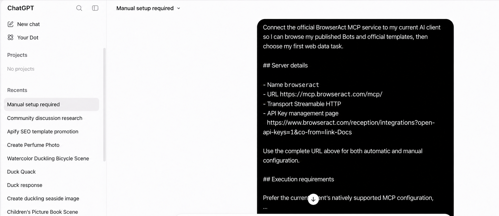

#### 2. Add a custom MCP server

Open ChatGPT's settings or customization area. Select **Plugins → Add → Add custom MCP server**.

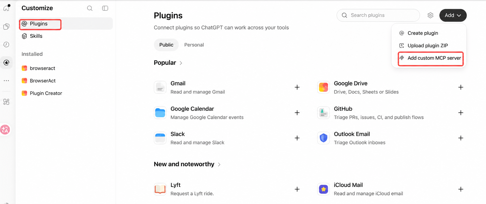

#### 3. Enter the connection details

| Field | What to enter |
| --- | --- |
| Name | `browseract`, or another name you can recognize |
| Description | Optional; for example, “Find and run BrowserAct Bots and official templates.” |
| Connection | Server URL |
| Server URL | The complete MCP URL from your BrowserAct setup guide |
| Authentication | OAuth |
| Icon | Optional |

Keep the detected OAuth settings unless your client's guide says otherwise. Submit the form.

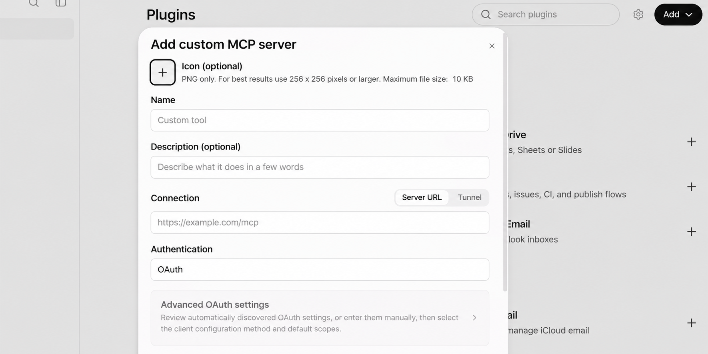

#### 4. Confirm the connection in ChatGPT

Review the connection notice and click **Connect**. The example uses the name `browseract-new`.

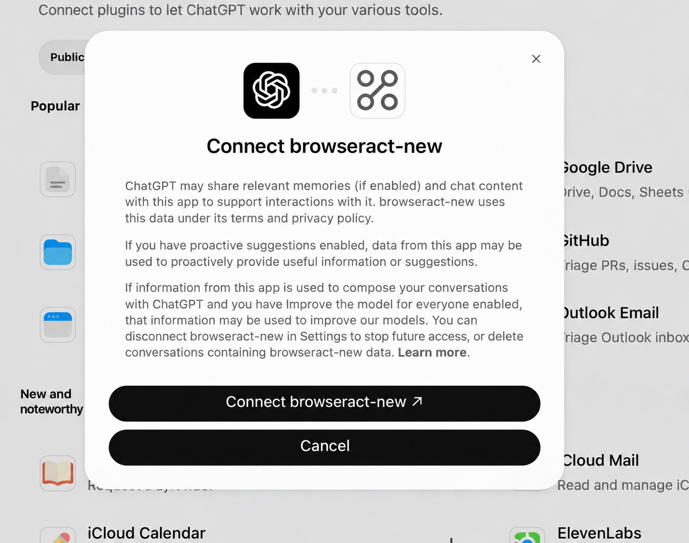

#### 5. Allow access in BrowserAct

Sign in if prompted. Check your account and the requested access, then click **Allow access**.

Authorization covers your user and company, including built-in tools and current and future eligible Custom tools. Existing permissions, published configuration, and Expose settings still apply. Runs may use company credits; authorizing does not start a Task.

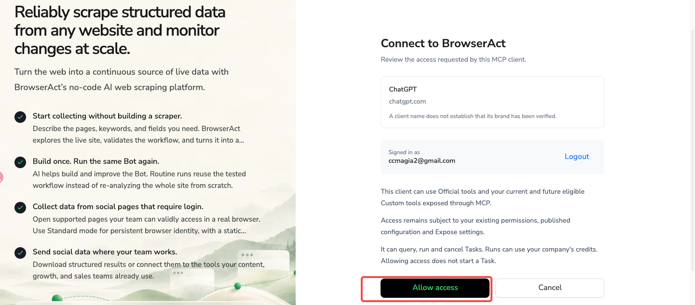

Select **Cancel** to decline this attempt or **Logout** to switch accounts. Canceling does not revoke existing access or stop Tasks. Closing the page does not approve access.

#### 6. Return to ChatGPT

Check that BrowserAct appears in your personal plugins with a connected account.

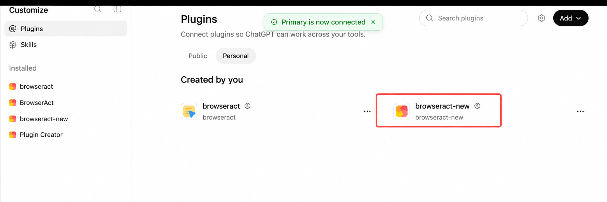

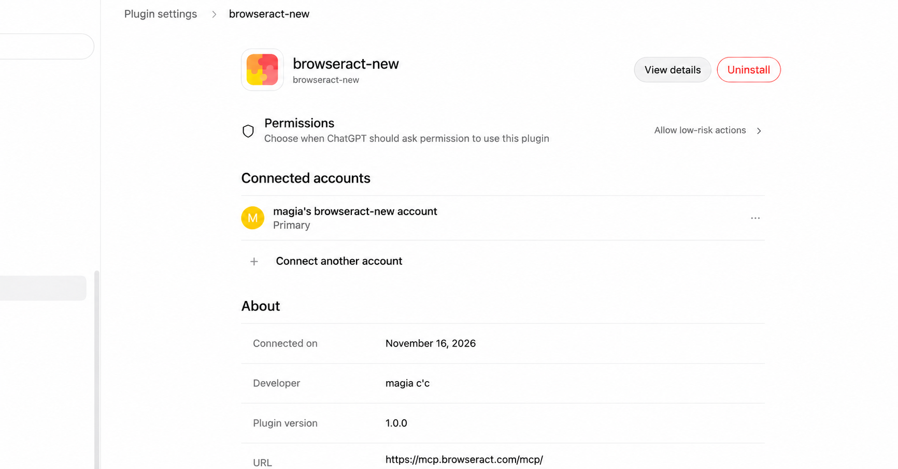

Next, verify that its tools work in the current chat.

### Verify the connection

Enable BrowserAct in your client's MCP settings. Ask the client to confirm the server URL and call `search_bots` and `search_official_templates`. It should report the search scope and pages checked, then suggest three tasks from the results.

Refresh the tool list or reload the session if needed. Verify with read-only queries; do not run a Task. For connection issues, see **Troubleshooting and FAQ**.

### Try your first request

Send this request:

```text
Find a BrowserAct official template for my reddit post comment extraction task and show me its required inputs before running it.
```

The reply shows a matching template and required inputs, without running a Task.

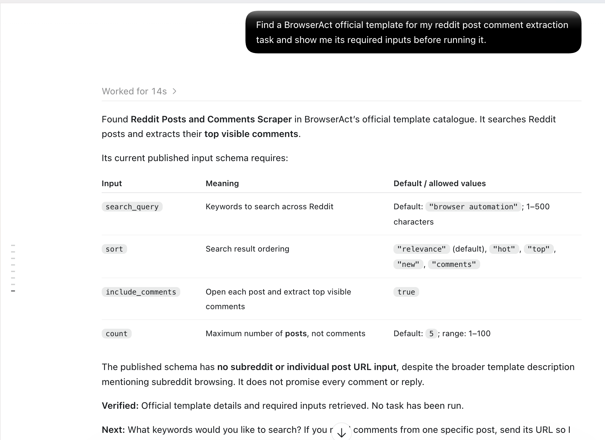

Continue below to run it and get results.

<span id="run-bots-or-official-templates" />

## Run Bots and Templates

### Run your published Bot

Describe your task or provide a Bot ID. Your agent checks required inputs, runs the Bot, and retrieves results.

```text
Run BrowserAct Bot [BOT_ID]. Ask me for any missing required inputs, then run once and retrieve the results.
```

### Run an official template

Describe your task or provide a template ID. Your agent checks required inputs, runs the template, and retrieves results.

```text
Run BrowserAct official template [TEMPLATE_ID]. Ask me for any missing required inputs, then run once and retrieve the results.
```

### Choose a proxy region for a template run

Ask your agent to find a supported region:

```text
Find the BrowserAct proxy region code for [country or region] and use it when I ask you to run official template [TEMPLATE_ID].
```

<span id="get-your-result" />

### Check progress and get results

A run returns a task ID. Keep it to check progress and retrieve results or available files.

Use `list_tasks` to find tasks, `get_task_status` to check progress, and `get_task` to get results. Use `cancel_task` to cancel a running or paused task.

### Rate limits and performance

There is no request rate limit. Concurrent task limits depend on your plan. Runs follow the existing credit rules; connecting does not start a run.

## Available tools

The unified connection provides 11 built-in tools. Access depends on the connected user and company.

| Tool name | Category | Enabled by default | Description |
| --- | --- | :---: | --- |
| `search_bots` | Bots | ✅ | Find published Bots accessible to your connected identity. |
| `get_bot_details` | Bots | ✅ | Get Bot details and input schema. |
| `run_bot` | Bots | ✅ | Run a published Bot and return a task ID. |
| `search_official_templates` | Templates | ✅ | Find available official templates. |
| `get_official_template_details` | Templates | ✅ | Get template details and input schema. |
| `run_official_template` | Templates | ✅ | Run an official template and return a task ID. |
| `list_proxy_regions` | Regions | ✅ | List supported proxy region codes and names. |
| `list_tasks` | Tasks | ✅ | Find existing tasks and their IDs. |
| `get_task_status` | Tasks | ✅ | Get the current task status. |
| `get_task` | Tasks | ✅ | Get task details, output, and available files. |
| `cancel_task` | Tasks | ✅ | Cancel a running or paused task. |

Exposed, accessible Custom tools appear alongside these tools. After changing Custom configuration, refresh the client's tool list. A valid authorization does not need renewed consent for this refresh.

## Manage your MCP connections

### View authorized clients

1. Open **[API & Integrations](https://www.browseract.com/reception/integrations?co-from=link-Docs)**.
2. Find **Authorized MCP Clients** below **API Keys**.
3. Review the client, source, grant ID, and **Authorized** time.
4. Click **Refresh** to update the list.

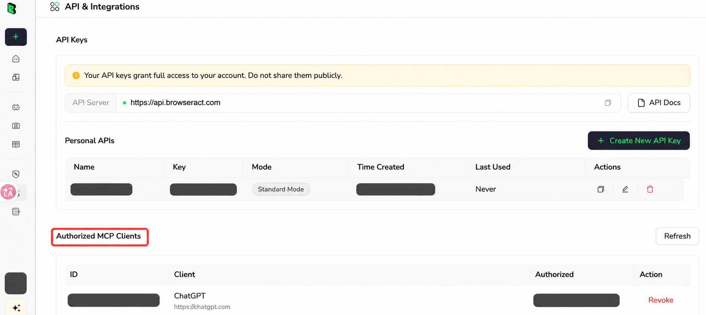

### Automatic renewal and reconnecting

Your client refreshes OAuth credentials automatically. Access Tokens last **2 hours**. Refresh Tokens expire after **30 days without a successful refresh**; each successful refresh restarts the period.

### Revoke access

Click **Revoke** and confirm. Successful revocation stops new access and refreshes across that grant's credentials. Already authenticated requests may finish; started Tasks keep running.

### Account changes and API Keys

Website logout, password changes, and account switching do not revoke OAuth grants or switch an existing MCP connection. Select or authorize another identity in your client.

Manage Keys in **[API & Integrations](https://www.browseract.com/reception/integrations?co-from=link-Docs) → API Keys**. Revoking a API Key stops every connection using it. OAuth grants must be revoked separately.

## Troubleshooting and FAQ

### Check the reported problem

| Problem | What to check |
| --- | --- |
| OAuth authorization fails | Return to the client and check its connection status. If authorization is still needed, start a new request there. Confirm the account and complete Allow access. |
| An old authorization link shows an error | Check whether the client is already connected. Close the old page if it is; otherwise, start a fresh authorization request from the client. |
| The login account changed during authorization | Review the updated account on the authorization card and decide again. Do not assume the original account was authorized. |
| API Key authentication fails | Use a valid API Key and `Authorization: Bearer …`. Check that the Key has not been revoked. |
| I see tools but not individual Bots | Bots and templates are discovered through search rather than all listed individually. Use search_bots or search_official_templates. Exposed Custom tools have their own visibility rules. |
| A Custom tool disappeared | Check Server status, Expose settings, the published Bot, and current permissions. Reauthorizing alone cannot restore a disabled resource. |
| Input validation fails | Read the current resource details. Supply required fields with the correct types. Check descriptions and defaults. |
| A run returned only an ID | This is expected. Query status, then retrieve the task result. |
| A run submission timed out | The request may already have created a task. Check by task ID, or reconcile the original submission before retrying. Do not submit a duplicate while the outcome is uncertain. |
| A region is rejected | Call list_proxy_regions and select a returned code. |
| A run fails | Read task details. Address the reported permission, input, balance, or website-access issue before choosing to run again. |

### Improve unclear input descriptions

If your client chooses the wrong tool or inputs, update the Bot and parameter descriptions.

#### Agent Built Bots

Open **Edit Bot**, update the Bot description or **Parameters**, and click **Save**.

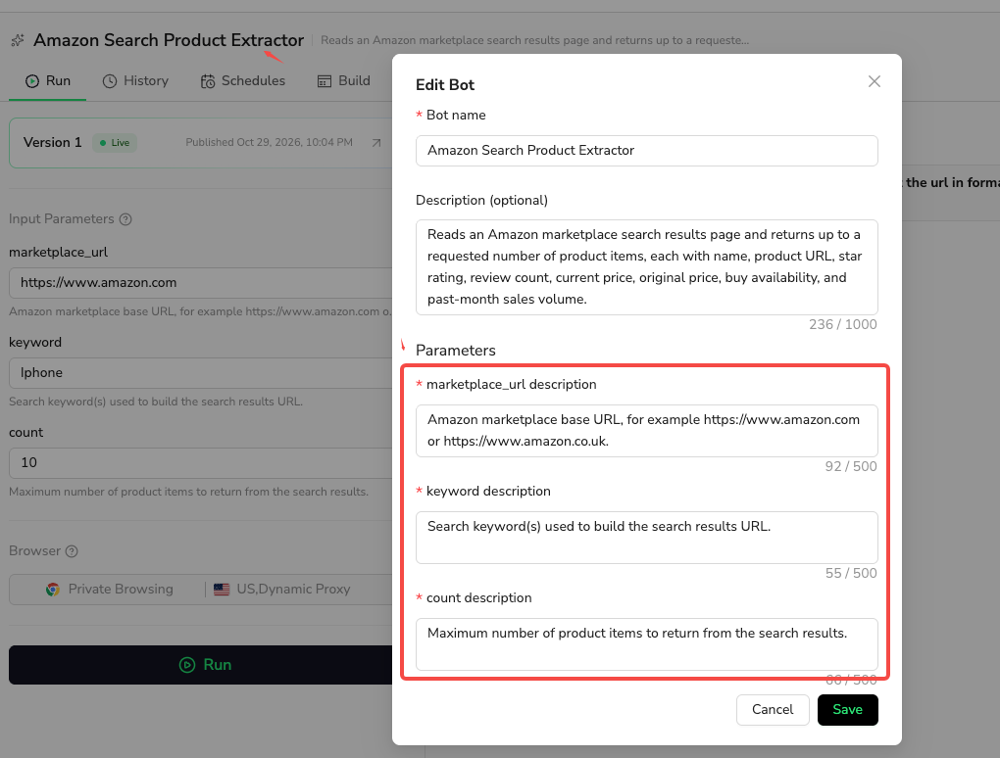

#### Workflow Built Bots

Edit the input **Description** in the **Start** node. Click **OK**, then **Publish**. Ask your client to read the updated tool details.

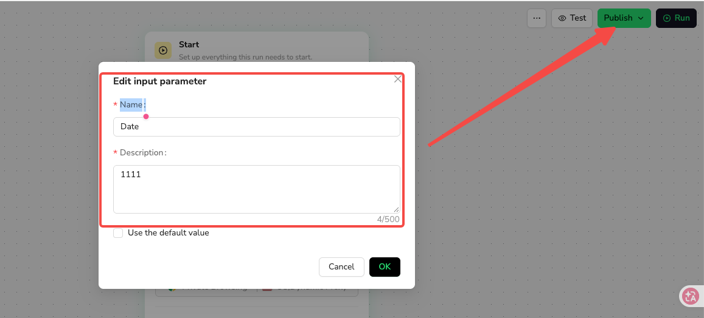

### A request timed out

Check the task by ID. If no ID was returned, find the original task before retrying to avoid duplicate runs.

### Set up a Custom MCP Server with selected Bot tools

Use a **Custom MCP Server** to expose selected Agent Built or Workflow Built Bot tools.

#### 1. Add a Server

Open [Manage Custom MCP Servers](https://www.browseract.com/reception/mcp-servers?co-from=link-Docs), click **Add**, and complete the form.

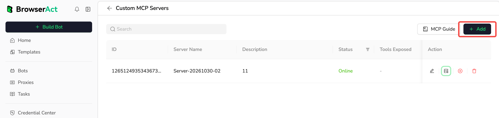

#### 2. Expose Bot tools

In the Server's **Action** column, click the management icon.

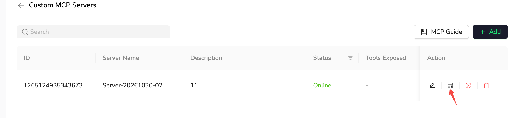

Open **Exposed Tools → Not Exposed**. Select published Bot tools, click **Expose**, and confirm. Publishing alone does not expose a Bot to this Server.

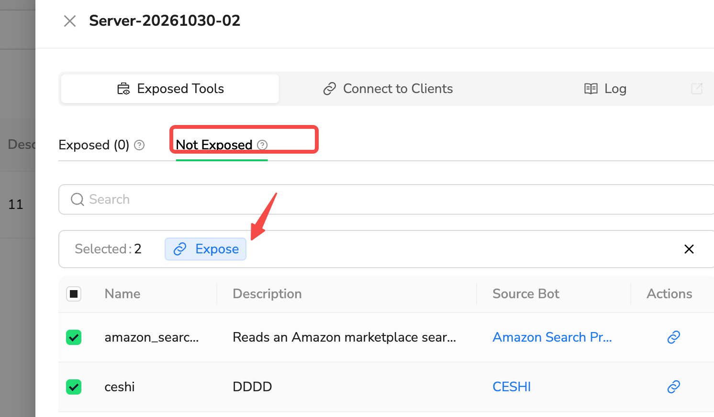

#### 3. Connect a single Server

Open this Server's **Connect to Clients**. Copy its MCP URL and configure it in your client with a API Key. Keep the Server online and confirm that its exposed tools are available.

### Frequently asked questions

**Can I use the same API Key for global and Custom MCP connections?**

Yes. A API Key works with unified MCP, Custom Server URLs, and supported public REST APIs, subject to current permissions. Manage it in **[API & Integrations](https://www.browseract.com/reception/integrations?co-from=link-Docs) → API Keys**. Use separate Keys for independent revocation.

**Do I need an API Key for OAuth?**

No. Sign in and authorize BrowserAct. Existing valid Key connections can still be used.

**Do I need to expose each Bot before using BrowserAct MCP?**

No. Built-in tools can find accessible Bots and run published Bots. Expose settings apply to Custom tools.

**Does one authorization cover every client or company?**

No. Each grant belongs to a user, company, and client. Authorize other clients or identities separately. Switching website accounts does not switch an existing connection.

**Does granting access run a Bot?**

No. A Task starts when you request a run and provide the required inputs.

**Can I change the tool list with a URL parameter?**

No. Use Custom Server Expose settings; URL `?tools=` filtering is not supported.

**Can I resume a task through MCP?**

No. Check the task details to decide your next step.
